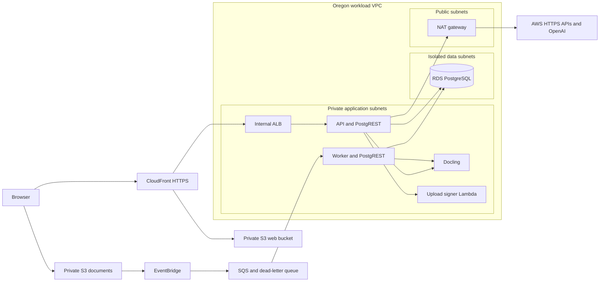

# Cortéx backend and AWS infrastructure

Cortéx is a document-grounded chat application for SolluCIO. Users sign in to an organization/workspace, upload documents, ask questions with citations, and manage conversations, personas, preferences and memory according to their role.

This repository contains the Fastify API, document ingestion code, Docling parser service, database migrations, local development launcher, and AWS CDK infrastructure. The browser application lives in [cortex-ui-mvp](https://github.com/cortex-ai-core/cortex-ui-mvp).

This README describes the **`aws-migration` branch**: Francis's AWS backend conversion combined with the companion UI's `ian` lineage and the Oregon migration work. Existing Supabase/Vercel-era files remain in the tree; their presence does not describe the active AWS runtime.

## Contents

- [Start locally](#start-locally)
- [How the application works](#how-the-application-works)
- [Code map](#code-map)
- [Configuration and secrets](#configuration-and-secrets)
- [AWS architecture and network](#aws-architecture-and-network)
- [Infrastructure and deployment](#infrastructure-and-deployment)
- [Verification](#verification)
- [Troubleshooting](#troubleshooting)
- [Migration, recovery and remaining acceptance](#migration-recovery-and-remaining-acceptance)
- [Further documentation](#further-documentation)

## Start locally

### Prerequisites

- Node.js **24** and npm; use the committed lockfiles with `npm ci`.
- Docker Desktop running, with Docker Compose v2. Document parsing needs a container with 4 GB RAM and 2 CPUs, plus capacity for the database and host processes.
- AWS CLI v2 and a dedicated **SolluCIO Cortex-Dev** login/profile for account **909762691423**, region **us-west-2**.
- An enabled, email-verified user already present in the **Oregon Dev Cognito pool**. Setup links that identity to a synthetic local workspace; it does not create a Cognito user or copy the Ohio dataset.
- Permission to read the Dev Data stack outputs, the Cognito user/app-client configuration, and the OpenAI secret used by local setup.
- Both repositories checked out as sibling folders on `aws-migration`:

```text
repositories/
├── cortex-mvp/          # this repository
└── cortex-ui-mvp/       # companion frontend
```

For a fresh checkout, from your chosen parent directory:

```bash
git clone --branch aws-migration https://github.com/cortex-ai-core/cortex-mvp.git
git clone --branch aws-migration https://github.com/cortex-ai-core/cortex-ui-mvp.git
cd cortex-mvp
npm ci
npm --prefix ../cortex-ui-mvp ci
```

For existing checkouts, preserve uncommitted work before switching branches. The combined launcher resolves `../cortex-ui-mvp` relative to the backend working directory, so run the commands below from the backend repository root.

### 1. Authenticate to the correct AWS account

Examples use the profile name `cortex-dev`; configure your dedicated SolluCIO profile first, or substitute its actual name. If using IAM Identity Center, sign in with:

```bash
# Clear exported session credentials so they cannot override your selected profile.
unset AWS_ACCESS_KEY_ID AWS_SECRET_ACCESS_KEY AWS_SESSION_TOKEN
export AWS_PROFILE=cortex-dev
export AWS_REGION=us-west-2
export AWS_DEFAULT_REGION=us-west-2
aws sso login --profile "$AWS_PROFILE"
aws sts get-caller-identity --profile "$AWS_PROFILE"
```

The returned `Account` must be **909762691423**. Do not use a default or unrelated business profile. The setup/deployment guard independently checks the target account and Oregon region.

### 2. Create the local environment

Replace the example email with your existing Oregon Cognito login:

```bash
npm run setup:local -- --email YOUR_COGNITO_EMAIL
```

[setup.mjs](scripts/dev/setup.mjs) starts Docker PostgreSQL/PostgREST, installs the baseline and incremental migrations, creates a synthetic organization/workspace/user, links your Cognito subject, generates separate local secrets, and reads the Dev Cognito client/OpenAI configuration. Generated files are ignored by Git and written with owner-only permissions under `.local/dev/`.

The synthetic local user is a **super admin** for development. This does not change the user's Oregon application role. The local database starts without the migrated customer documents or chat history. The setup script retains a legacy Ohio identity-lookup fallback; use an Oregon user for the normal path. An unexpected Ohio lookup should be investigated rather than supplied with additional legacy credentials.

For schema work without any AWS access, use this alternative:

```bash
npm run setup:local -- --database-only
```

Database-only setup creates the schema and a synthetic fixture. It does **not** generate the full application configuration or prove sign-in, OpenAI, parsing or UI integration.

### 3. Prepare the parser image

Skip this build if the image is already cached locally:

```bash
docker build -t cortex-parser:aws-local parser
```

The first build is large and downloads document/OCR models. An approved image pulled from Oregon ECR can also be tagged `cortex-parser:aws-local`. See the [parser guide](parser/README.md) for its format, OCR and sizing details.

### 4. Start the backend, frontend and containers

```bash
# Include Docling for file attachments and document ingestion.
npm run dev:local -- --documents
```

Open **http://localhost:3003** and sign in with your existing Oregon Cognito credentials. For UI/chat development that does not need document parsing, use `npm run dev:local` without `--documents`.

| Component | Local address | Runs as |
|---|---|---|
| Next.js frontend | `http://localhost:3003` | Host process with hot reload |
| Fastify backend | `http://127.0.0.1:8082` | Host process with Node watch mode |
| PostgREST | `http://127.0.0.1:3004` | Docker container |
| PostgreSQL/pgvector | `127.0.0.1:5433` | Docker container and named data volume |
| Docling parser | `http://127.0.0.1:8091` | Optional Docker container |

The launcher supplies the frontend's backend URL and disables direct S3 upload locally. Local document files live in `.local/dev/storage/`; the API's local ingestion worker processes the local database queue. Cognito sign-in and OpenAI requests still use real cloud services. Local mode is **not fully offline** and does not exercise AWS S3/EventBridge/SQS delivery.

These ports deliberately avoid Francis's original UI/API/PostgREST/parser ports `3002/8081/3001/8090`. His `npm run start:aws` loads `.env.aws` and may still point at Ohio. Use the combined local launcher for this setup.

### 5. Check and stop

```bash
curl --fail http://127.0.0.1:8082/api/health
curl --fail http://127.0.0.1:8091/health
docker compose ps
```

The parser check applies only when it is running. API health is a liveness response; it does not prove database access, sign-in or successful ingestion.

Press **Ctrl+C** in the launcher terminal to stop the host processes. Then:

```bash
npm run stop:local
```

Stopping containers preserves the named database volume and local files. Do not add `-v` to Compose shutdown unless deliberately discarding the synthetic database. Container shutdown does not delete `.local/dev/storage/`.

## How the application works

### Sign-in and authorization

The frontend submits credentials to `/api/auth/login`. The AWS authentication adapter authenticates against Cognito, verifies its tokens, resolves an immutable issuer/subject identity link to the application user, and issues the application session used by subsequent API requests. First-login password changes and password-reset screens are part of the companion UI.

The API determines user identity, role, organization and workspace from the authenticated session and application data. Workspace membership is checked again on protected requests; a browser-provided workspace ID is not permission to access another workspace. UI permission checks improve the interface, while backend checks enforce access.

### Document-grounded questions

1. The UI sends the question, conversation reference and optional attachment text.
2. The API validates access and resolves the persona/preferences and applicable memory settings.
3. Retrieval finds relevant stored document chunks for the authenticated workspace.
4. Reasoning/synthesis builds the model context and calls OpenAI.
5. The backend returns an answer and citation/source metadata, either as JSON or server-sent events. Normal conversations are persisted according to application policy.

An unrelated greeting can return “No matching documents” because this is a document-grounded application. Test retrieval with a question about a known, ready document.

### Temporary chat attachments versus the document library

| Behavior | Chat: “Attach files” | “My documents” upload |
|---|---|---|
| Purpose | Context for the current conversation | Durable, searchable knowledge base |
| Initial request | `POST /api/attachments/parse` | Local multipart upload, or AWS signed-upload API |
| Parsing | Text/Markdown directly; other supported files through Docling | Background ingestion through Docling |
| Persistence | Parsing creates no document, storage object or trace record | Original files, document metadata and derived searchable content |
| Later questions | Extracted text accompanies the chat request | Retrieval reads indexed chunks |

Temporary attachment parsing requires `upload_ephemeral` permission: super admin, admin or operator. It also requires current workspace membership. The default file limit is 50 MB; extracted attachment context is bounded to 400,000 characters and chat JSON bodies to 8 MB. Edge, proxy and parser time limits can impose additional practical constraints.

Private mode uses attached context instead of the shared knowledge base, skips saved conversations/memory writes, and omits query/conflict text from retrieval traces. Trace metadata can still exist. Files/questions still reach the backend/parser and applicable AI services for processing; see [retention and privacy behavior](docs/RETENTION.md).

### Persistent document ingestion

In AWS, the API authorizes a document upload and invokes a private upload-signing Lambda. The browser sends the original directly to S3 using a short-lived signed request bound to the expected size/type/checksum. Completion validates the object. S3 object events flow through EventBridge into SQS; the worker claims a document, calls Docling, generates embeddings/derived content and updates status to ready.

The worker uses atomic claims and heartbeats. Duplicate deliveries are expected; failures retry and can enter the dead-letter queue. A successful S3 upload or API health check does not mean indexing has completed. Locally, the multipart/local-storage path and in-process queue polling replace this AWS delivery path.

## Code map

### This repository

| Entry point | Responsibility |
|---|---|
| [server.js](server.js) | Environment import, Fastify plugins, shared clients, health, route allowlist and worker startup |
| [backend/routes/](backend/routes/) | HTTP handlers for authentication, chat, attachments, documents, retrieval, conversations, memory and settings |
| [backend/lib/authMiddleware.js](backend/lib/authMiddleware.js), [permissions.js](backend/lib/permissions.js) | Session validation, current-user checks, role actions and workspace membership |
| [backend/lib/services/](backend/lib/services/) | Authentication, database and storage adapters for AWS/local/legacy providers |
| [backend/retrieval/](backend/retrieval/) | Hybrid retrieval and trace recording |
| [backend/reasoning/](backend/reasoning/) | Intent, context, synthesis and output handling |
| [backend/ingest/](backend/ingest/) | Queue semantics, parser client, storage, summaries and ingestion worker |
| [backend/memory/](backend/memory/), [backend/pcl/](backend/pcl/) | Memory policy and persona configuration resolution/validation |
| [backend/retention/](backend/retention/) | Conversation archive, summary, purge and scheduling |
| [parser/](parser/) | Python Docling HTTP service, OCR and rendering |
| [database/](database/) | Captured baseline manifest and ordered SQL migrations |
| [scripts/dev/](scripts/dev/) and [compose.yaml](compose.yaml) | Local provisioning and combined launcher |
| [scripts/aws/](scripts/aws/) | AWS runtime entry points, migration utilities and original setup scripts |
| [scripts/deploy/](scripts/deploy/) | Account guards, reviewed change-set deployment, controlled database tasks and image publication |
| [infra/](infra/) | CDK TypeScript infrastructure, environment configuration and synthesis tests |
| [tests/migration/](tests/migration/) | Isolated regression tests for the AWS migration/local adapters and attachments |

When adding a route file, register it in `server.js`'s explicit `allowedRoutes` set. Merely creating a file in `backend/routes/` does not load it. `search.js` is intentionally outside that allowlist. Historical `.bak` files and root `app/` files are not the companion UI entry point or additional deployed services.

The database adapter still uses the Supabase JavaScript client's query-builder interface. In AWS mode it redirects those requests to our own private PostgREST process backed by RDS. The variable name `supabase` does not imply access to hosted Supabase.

### Companion frontend

These links refer to the [UI repository's `aws-migration` branch](https://github.com/cortex-ai-core/cortex-ui-mvp/tree/aws-migration):

| File | Responsibility |
|---|---|
| [app/ChatClient.tsx](https://github.com/cortex-ai-core/cortex-ui-mvp/blob/aws-migration/app/ChatClient.tsx) | Main chat screen, attachment chips, private mode and conversation state |
| [app/login/page.tsx](https://github.com/cortex-ai-core/cortex-ui-mvp/blob/aws-migration/app/login/page.tsx) | Login and first-password-change flow |
| [app/reset-password/page.tsx](https://github.com/cortex-ai-core/cortex-ui-mvp/blob/aws-migration/app/reset-password/page.tsx) | Password reset screen |
| [app/document/page.tsx](https://github.com/cortex-ai-core/cortex-ui-mvp/blob/aws-migration/app/document/page.tsx) | Document-library screen |
| [lib/sendChat.ts](https://github.com/cortex-ai-core/cortex-ui-mvp/blob/aws-migration/lib/sendChat.ts) | Chat requests, streaming and source metadata |
| [lib/attachmentsApi.ts](https://github.com/cortex-ai-core/cortex-ui-mvp/blob/aws-migration/lib/attachmentsApi.ts), [lib/documentsApi.ts](https://github.com/cortex-ai-core/cortex-ui-mvp/blob/aws-migration/lib/documentsApi.ts) | Temporary attachment and persistent document API clients |
| [lib/backend.ts](https://github.com/cortex-ai-core/cortex-ui-mvp/blob/aws-migration/lib/backend.ts) | Backend base URL; an explicit empty value selects same-origin API requests |
| [next.config.ts](https://github.com/cortex-ai-core/cortex-ui-mvp/blob/aws-migration/next.config.ts) | Static export, build directory and static image behavior |

The AWS UI is a Next.js/React **static export**, not a Next server on Fargate. Adding SSR, server actions, middleware or Next API endpoints requires revisiting hosting. Browser variables prefixed `NEXT_PUBLIC_` are public build-time values, never a place for secrets.

## Configuration and secrets

Environment loading happens before modules read configuration. See [env.js](backend/lib/env.js).

| Execution path | Configuration source |
|---|---|
| `npm run dev:local` | `CORTEX_ENV=local`, generated `.local/dev/app.env` |
| `npm run start:aws` | `CORTEX_ENV=aws`, legacy `.env.aws` |
| `CORTEX_ENV=production` | `.env.production` |
| Default `npm start` / `npm run dev` | `.env` unless another mode is explicitly selected |
| ECS API / worker | CDK-defined environment, Secrets Manager injection and task IAM roles |

The plain `start`/`dev` commands are not substitutes for `dev:local`: without the local mode they can select a different database/provider. Local mode/storage is rejected with `NODE_ENV=production`.

| Setting | Purpose |
|---|---|
| `BACKEND_PROVIDER` | Selects `aws` or the legacy `supabase` adapter |
| `AWS_REGION`, `CORTEX_ACCOUNT_ID` | Explicit regional/runtime account checks |
| `AWS_CORTEX_JWT_SECRET` | Application session signing; at least 32 characters |
| `RDS_REST_URL`, `RDS_REST_JWT_SECRET` | PostgREST origin and separate database API signing secret |
| `COGNITO_USER_POOL_ID`, `COGNITO_CLIENT_ID`, `COGNITO_CLIENT_SECRET` | Cognito sign-in configuration; client secret remains server-side |
| `OPENAI_API_KEY` | Model/embedding access |
| `PARSER_URL`, `PARSER_SECRET`, `PARSER_TIMEOUT_MS` | Docling address, shared secret and parser timeout |
| `S3_DOCUMENTS_BUCKET`, `UPLOAD_SIGNER_NAME`, `INGEST_QUEUE_URL` | AWS storage, direct uploads and queued ingestion |
| `INGEST_WORKER` | Local API polling is on; cloud API polling is off because a separate SQS worker runs |
| `RETENTION_SWEEP_MINUTES` | Currently `0` in local/Dev deployment to disable automatic sweeps |
| `MAX_UPLOAD_MB`, `MAX_EPHEMERAL_CONTEXT`, `BODY_LIMIT_MB` | Multipart file, extracted-context and JSON-body limits |

[.env.example](.env.example) documents additional retrieval, memory, persona and retention options. It is not a complete generated local configuration. Application and PostgREST signing secrets must differ. Do not commit `.env` files, `.local/`, user passwords, session credentials, private verification reports or customer documents. GitHub releases use OIDC; ECS uses task roles and Secrets Manager. No AWS access keys belong in frontend code or repository secrets for these workflows.

## AWS architecture and network

### Accounts and environment sizing

All regional workload environments target **Oregon (`us-west-2`)**. Account IDs are deployment identifiers, not credentials.

| Environment | Account | VPC CIDR | Configured sizing |
|---|---|---|---|
| Dev | `909762691423` | `10.10.0.0/16` | Two AZs, one NAT, single RDS, one API/parser/worker task |
| Test | `223323955607` | `10.20.0.0/16` | Separate account, Dev-style sizing; not yet deployed |
| Prod | `474711723859` | `10.30.0.0/16` | Three AZs/NATs, Multi-AZ RDS, two API tasks; parser/worker remain one each; not yet deployed |

Central VPC Flow Logs use the separate **Log Archive** account `747301449112`. Audit/security administration is separate from workload deployment. Provisioning Dev does not provision Test/Prod or configure every organization-level security control.

### Traffic and service placement



Arrows show logical requests/data flow; the network controls below determine connectivity. The browser-to-document-bucket request requires a short-lived signed authorization. SQS is polled by the worker; it does not open an inbound connection to a task.

| Dev tier | Subnets | Placement and routes |
|---|---|---|
| Public | Two `/24` subnets across two AZs | Internet-gateway route; one public NAT gateway in Dev |
| Private application | Two `/24` subnets across two AZs | API, worker, parser, internal ALB, signer Lambda and controlled database task; outbound default routes through Dev NAT |
| Isolated data | Two `/24` subnets across two AZs | RDS subnet group; no internet default route |

- **ECS** manages task definitions and services; **Fargate** supplies container compute without application-managed EC2 hosts. Tasks have no public IPs. The API and worker each include a loopback-only PostgREST sidecar; Docling is discovered through private Cloud Map DNS.
- **NAT** permits allowed outbound connections, such as OpenAI/AWS HTTPS requests. It does not admit inbound internet requests to private tasks. A single Dev NAT is an availability/cost tradeoff, not AZ-independent egress.
- **Security groups** permit the named service paths: ALB to API, application to parser, and application/operations to RDS. External workload egress is restricted to HTTPS. The default security group has no ingress or egress rules.
- **RDS** is private, encrypted, deletion-protected and accessed with TLS. Two data subnets do not imply two Dev database instances; Dev is single-instance and Prod configuration enables Multi-AZ.
- **S3** web/documents/archive buckets are private and versioned. CloudFront uses origin access control for web files. An S3 gateway endpoint provides private application access without NAT traversal.
- **Cognito, S3, SQS, EventBridge and CloudFront** are managed services outside the workload subnets. IAM/resource policies control access; describing all AWS resources as “inside private subnets” would be inaccurate.
- **CloudWatch** receives service logs/metrics. VPC Flow Logs deliver to the dedicated Log Archive S3 destination, with the local CloudWatch copy retained during transition. Flow-log delivery can report `SKIPDATA`; successful delivery is not a guarantee of lossless traffic capture.

### Current load-balancer variation

The guidebook describes a public load-balancer tier. The current Dev design deliberately retains a **private ALB behind a CloudFront VPC origin**, pending an approved domain/DNS input. Viewer access uses HTTPS; the private origin hop is explicitly HTTP port 80. ALB ingress permits AWS's Oregon CloudFront origin-facing managed prefix list.

This is not full end-to-end origin TLS or a completed public-tier guidebook implementation. Changing the protocol of an attached CloudFront VPC origin requires a versioned new origin and distribution switch; an in-place update fails. See the [compliance plan](docs/aws-guidebook-compliance-plan.md) for the outstanding decision and acceptance criteria.

## Infrastructure and deployment

### CDK produces CloudFormation

Infrastructure source is TypeScript in `infra/`; synthesized CloudFormation is a build artifact, not the source to hand-edit. [Environment configuration](infra/lib/config.ts) defines account/CIDR/sizing; [environment JSON](infra/environments/) pins image versions, the Dev source snapshot and its public origin.

| Stack | Source | Owns |
|---|---|---|
| `cortex-ENV-foundation` | [foundation.ts](infra/lib/foundation.ts) | VPC/subnets/routes/NAT, default-group hardening, Flow Logs, S3 endpoint, KMS, ECR and GitHub deployment identities |
| `cortex-ENV-data` | [data.ts](infra/lib/data.ts) | RDS, storage buckets, secrets, Cognito and private upload signer |
| `cortex-ENV-operations` | [operations.ts](infra/lib/operations.ts) | ECS cluster and private controlled database task |
| `cortex-ENV-application` | [runtime.ts](infra/lib/runtime.ts) | API/parser/worker services, ALB, service discovery, SQS/events and operational alarms |
| `cortex-ENV-delivery` | [delivery.ts](infra/lib/delivery.ts) | CloudFront static/API routing and private ALB origin |
| `cortex-central-flowlogs` in Log Archive | [log-archive.ts](infra/lib/log-archive.ts) | Dedicated central bucket, retention and delivery policy |

The central destination currently enables Dev delivery; Test/Prod require their own source-account policy and flow-log configuration. Do not assume a Dev deployment activates central logging for all environments.

### GitHub Actions release paths

Backend workflow: [.github/workflows/aws.yml](.github/workflows/aws.yml). The companion UI has its own workflow.

| Trigger | Backend | Frontend |
|---|---|---|
| Pull request | Regression tests, infrastructure type/tests and synthesis; no deployment | Static build; no deployment |
| Push to `aws-migration` | Verify, then deploy Dev | Build, then publish Dev |
| Manual dispatch | Select Dev/Test/Prod after matching account bootstrap and workflow availability | Select an already-provisioned environment |

The current workflow deploys on every push to `aws-migration`, including documentation changes. Deployment jobs are serialized per environment. GitHub obtains temporary role credentials through OIDC with account restrictions; it does not need long-lived AWS keys.

Backend release sequence:

1. Build an ARM64 API image and publish an immutable commit/run/attempt tag to ECR.
2. Synthesize templates using that image override.
3. Apply reviewed Data/Operations change sets.
4. Run the controlled database migration/validation task in private subnets.
5. Apply Application/Delivery change sets and wait for completion.
6. Check the public `/api/health` endpoint.

Normal release excludes Foundation/IAM changes and rejects resource removals or replacements of protected state-bearing resource types. Parser/PostgREST images are pinned independently; ordinary API releases do not rebuild them. Review/build/publish those images and update their versions explicitly when needed.

Frontend release builds with same-origin API calls and direct S3 uploads, publishes hashed assets before HTML, retains older hashed assets for active browser sessions and invalidates CloudFront. No Next server runs in AWS. Frontend/backend releases are independent: deploy a compatible backend before UI code that requires it.

Do not blindly deploy CDK using the saved Dev `image` value: normal release overrides it with the newly built tag, while the saved fallback may identify an older image. Use the reviewed workflow/release tooling and inspect change sets. Keep the Dev restored-database snapshot property stable; removing/changing it can propose database replacement.

### Database changes, rollback and new environments

- Add a new ordered SQL migration; do not modify an already-applied migration. Cloud migration execution uses recorded checksums and an advisory transaction lock. Local setup currently lists incremental migrations explicitly, so add future migrations to that setup path as well.
- Keep SQL backward compatible across rolling deployments. Rolling back an image does not undo schema changes or application writes.
- Backend rollback redeploys a previously tested immutable image through the release path. ECS circuit breakers help recover failed service rollouts. Frontend rollback reverts/redeploys source; S3 versions provide additional recovery options.
- RDS restore is a separate reviewed recovery operation into an appropriate private target. It is not an automatic application rollback.
- Test/Prod need their own account bootstrap, deployment identities, secrets, image publication, approved dataset, logging setup, domains and GitHub environment protections. Prod also needs reviewed scaling/availability and operational acceptance. Do not copy customer data there implicitly.

## Verification

### Automated local checks

From the backend root:

```bash
npm run test:migration
npm ci --prefix infra
npm run build --prefix infra
npm test --prefix infra
```

To synthesize the full Dev deployment without AWS lookups:

```bash
CDK_DEFAULT_ACCOUNT=909762691423 \
CDK_DEFAULT_REGION=us-west-2 \
AWS_REGION=us-west-2 \
AWS_DEFAULT_REGION=us-west-2 \
AWS_EC2_METADATA_DISABLED=true \
npm run synth --prefix infra -- \
  -c environment=dev -c includeData=true -c includeRuntime=true \
  --no-lookups --quiet
```

Synthesis writes `infra/cdk.out/`; it does not deploy. These checks cover migration adapters/queue behavior, identity linking, local storage, attachment routing/access/error handling and infrastructure guards. Attachment regression tests boot the real server with synthetic database/parser dependencies; they do not contact live RDS, Cognito or OpenAI.

Current synthesis emits two relevant CloudFront warnings: a custom minimum TLS policy does not apply to the generated-domain default certificate, and Delivery cannot automatically modify its imported web bucket's policy. Data owns the explicit account-scoped CloudFront read policy. Review that policy and complete custom-domain/certificate TLS acceptance before production; successful synthesis does not remove these constraints.

The root `npm test` is an unconfigured placeholder. Use the named commands above. Historical smoke/eval scripts can require particular accounts, schemas and data and can write to their target; inspect their setup before running them against a shared environment.

### Local functional acceptance

1. Confirm the ports/containers, then sign in through the UI.
2. Confirm the workspace is the synthetic local workspace, not the migrated Oregon dataset.
3. Upload a small synthetic document in “My documents”; wait until ready, then ask a question with a recognizable answer and inspect citations.
4. Separately attach a synthetic PDF/text file in chat and ask about its contents. Check private mode and retry behavior as well.
5. Reload normal chats to check persistence. Use an appropriate additional role/workspace fixture for authorization checks.

The schema-only local path has been verified. Full local Cognito/OpenAI/UI acceptance must be run with a developer's configured profile; database-only success does not establish it.

### AWS console and application checks

Use Cortex-Dev **909762691423**, **Oregon**, and the [Dev application](https://d3ni3zlrnsq9j7.cloudfront.net/). Read the [operating guide](docs/aws-migration.md) for detailed acceptance.

| Console area | Check |
|---|---|
| CloudFormation | Expected stack statuses and outputs; review failed stack events |
| ECS → `cortex-dev` | API/parser/worker steady, expected task revisions, private ENIs and no public IPs |
| VPC | Public/application/isolated routes, available NAT, empty default security group and successful central Flow Logs |
| RDS | Available, public access off, encryption/TLS/deletion protection and backups |
| Lambda | Upload signer active in private application subnets with its named group |
| SQS | Ingestion age/backlog and dead-letter queue; inspect failures before any deliberate redrive |
| CloudWatch | API/parser/worker/database-task logs and alarms |
| S3 / Cognito | Private/versioned objects and correct Oregon identities; avoid exposing object bodies or credentials |
| GitHub Actions | Both repositories' actual push deployment results, not just PR verification |

Test existing documents, a new persistent upload, chat attachments, cited answers, private mode, role/workspace isolation and reload behavior through the deployed UI. Successful API health does not establish these flows. Snapshot migration verification and prior functional smoke results are point-in-time evidence recorded in the operating/handoff guides; repeat relevant checks after changes. The attachment route restoration passed isolated regression and deployment checks; post-deployment Safari composer acceptance remains pending in the current handoff.

## Troubleshooting

| Symptom | Checks and next step |
|---|---|
| `Account mismatch` or wrong region | Inspect `aws sts get-caller-identity` using the selected SolluCIO profile. Clear stale exported credentials and select Oregon. Do not work around the guard. |
| Local launcher says configuration is missing | Run full `setup:local -- --email ...` from the backend root. `--database-only` does not produce `app.env`. |
| Frontend starts against the wrong API | Use the combined launcher and port 3003. It injects `NEXT_PUBLIC_BACKEND_URL=http://localhost:8082`; the UI fallback is the older 8081 port. |
| `JWT_SECRET: MISSING` in AWS startup diagnostics | AWS sessions use `AWS_CORTEX_JWT_SECRET`. Check the provider-specific configuration instead of adding an unrelated legacy secret. |
| `retention: schema not ready` / `fetch failed` | Health can still pass. Check the configured PostgREST address/container, database reachability/TLS and schema. In shared Dev, do not enable retention to diagnose connectivity. |
| “Attach files” returns `Not Found` | Check that backend/UI versions match and `/api/attachments/parse` is registered in the server allowlist. This was missing on Francis's backend branch and is covered by the restoration regression test. |
| Parser unavailable or file cannot be read | Start with `--documents`, check port 8091 health and `docker compose logs --tail 100 parser`; confirm image, shared secret, supported type and memory. |
| Upload stays queued | Local: check parser/API worker logs. AWS: distinguish “Waiting for upload” from ingestion, then check S3 completion, SQS, worker claims and DLQ. |
| Empty local knowledge base | Expected for a fresh synthetic database. Upload a test document; local setup does not copy Ohio/RDS documents. |
| UI still shows an error after deployment | Refresh once the backend push deployment is green, repeat the exact action, and inspect its status/message. A green liveness check alone is insufficient. |
| CloudFront returns 502/504 | Inspect API health, ALB target health, private-origin protocol and ingress, then parser/request duration. Current private ALB listens on HTTP80, not HTTPS443. |
| CDK says an attached VPC origin cannot change | Use a separately reviewed new origin/distribution switch; do not repeatedly retry an in-place protocol change. |
| Failed Vercel statuses on a PR | Legacy Vercel integrations still report independently. Inspect their own logs/configuration; an AWS green check does not explain their failure. Do not disable existing production hosting as a workaround. |

Logs and diagnostic reports may contain work data. Share only the relevant redacted error; never paste configuration files or session credentials into commits/issues.

## Migration, recovery and remaining acceptance

The Ohio RDS snapshot was independently copied/restored into Oregon. Before application writes, all **25 application tables / 8,404 rows** matched source counts/fingerprints and all **35 current S3 objects** passed full SHA-256 checks. Fifteen Cognito users were transferred to a new Oregon pool with required first-login password changes. Immutable identity provenance preserves links to existing application accounts; no Ohio password bridge is required.

This was a **point-in-time copy, not continuous replication**. Later Ohio writes do not automatically appear in Oregon. Agree a write cutoff and reconcile both sides before retirement; never restore an old snapshot over a now-active Oregon database. Verification reports and source identity metadata are retained in the private encrypted/versioned Oregon migration archive, not in Git.

**Ohio retirement is manual and belongs to Sanjay after Oregon and both Actions paths are accepted.** Nothing in the local launcher or normal release retires Ohio. Follow the separate [Ohio retirement runbook](docs/ohio-retirement.md), including independent Oregon restore verification, final data/file reconciliation, ownership/dependency checks and retained encryption keys/backups.

Dev application deployment is not a claim of complete guidebook or production readiness. Remaining acceptance includes public-ALB/DNS/origin TLS alignment, confirmed operational alert subscribers, Audit-owned GuardDuty Fargate runtime monitoring, AWS Backup planning and restore exercises, production WAF/TLS readiness, and GitHub environment protection/admin settings. RDS native backups currently retain seven days; they do not establish an organization-wide backup plan. Recovery-email delivery and the full local UI flow need explicit verification. See the [compliance plan](docs/aws-guidebook-compliance-plan.md) for scope and ownership.

Continuously running Fargate, RDS, NAT and the ALB incur ongoing costs, along with storage, traffic, logs and OpenAI use. Dev is not a scale-to-zero deployment; budget/alert ownership and actual workload estimates should guide further sizing.

## Further documentation

- [AWS migration and operations](docs/aws-migration.md): release details, verified migration evidence and local setup.
- [Guidebook compliance plan](docs/aws-guidebook-compliance-plan.md): network/logging requirements, exceptions and remaining acceptance.
- [Ohio retirement](docs/ohio-retirement.md): gated manual retirement instructions.
- [AWS handoff](docs/aws-handoff.md): chronological implementation/debugging evidence; later entries supersede earlier temporary status.
- [Parser service](parser/README.md): API, extraction provenance, OCR and sizing.
- [Retention](docs/RETENTION.md) and [retention acceptance](docs/RETENTION_ACCEPTANCE.md).
- [Persona authoring](docs/PERSONA_AUTHORING.md) and [persona acceptance](docs/PCL_ACCEPTANCE.md).

Update this entry point when commands, ports, hosting or module ownership change. Keep detailed service policies and operational procedures in their linked owners. Record new verification with its environment and limits; do not turn a prior passing result into a claim about a later release.
