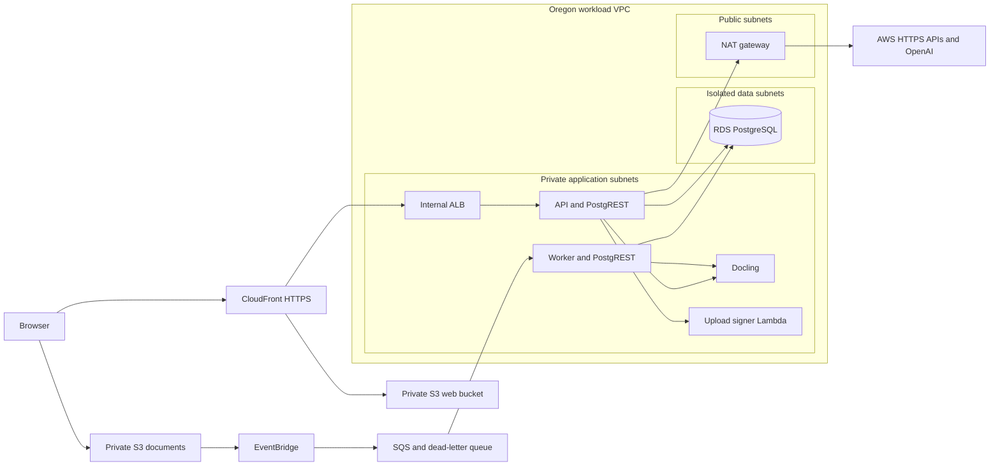

# Cortéx backend and AWS infrastructure


**Test deployment:** the `test` branch has a dedicated AWS pipeline for account `223323955607`. See [Test deployment](docs/test-deployment.md). Test starts with an empty database and Cognito pool; Prod remains disabled.

Cortéx is a document-grounded chat application for SolluCIO. Users sign in to an organization/workspace, upload documents, ask questions with citations, and manage conversations, personas, preferences and memory according to their role.

This repository contains the Fastify API, document ingestion code, Docling parser service, database migrations, local development launcher, and AWS CDK infrastructure. The browser application lives in [cortex-ui-mvp](https://github.com/cortex-ai-core/cortex-ui-mvp).

This README describes the **`feature/aws-conversion` source branch**, promoted through a pull request into **`dev`**: Francis's AWS backend conversion combined with the companion UI's `ian` lineage and the Oregon migration work. Existing Supabase/Vercel-era files remain in the tree; their presence does not describe the active AWS runtime.

**Open the Oregon Dev frontend:** [Cortex Dev](https://d3ni3zlrnsq9j7.cloudfront.net/) — sign in with your Cortex email and password. The frontend files are hosted in private S3 in Oregon and delivered globally through CloudFront. API, worker and parser containers run on ECS/Fargate. The [custom hostname](docs/custom-domain.md) has a separate staged certificate/DNS setup; do not assume a new alias is active before its acceptance checks pass.

## Contents

- [Start locally](#start-locally)
- [How the application works](#how-the-application-works)
- [Code map](#code-map)
- [Configuration and secrets](#configuration-and-secrets)
- [AWS architecture and network](#aws-architecture-and-network)
- [AWS Console walkthrough](#aws-console-walkthrough)
- [Infrastructure and deployment](#infrastructure-and-deployment)
- [Verification](#verification)
- [Troubleshooting](#troubleshooting)
- [Migration, recovery and remaining acceptance](#migration-recovery-and-remaining-acceptance)
- [Further documentation](#further-documentation)

## Start locally

### Prerequisites

- Node.js **24** and npm; use the committed lockfiles with `npm ci`.
- Docker Desktop running, with Docker Compose v2. Document parsing needs a container with 4 GB RAM and 2 CPUs, plus capacity for the database and host processes.
- AWS CLI v2 and a dedicated **SolluCIO Cortex-Dev** login/profile for account **909762691423**, region **us-west-2**.
- An enabled, email-verified user already present in the **Oregon Dev Cognito pool**. Setup links that identity to a synthetic local workspace; it does not create a Cognito user or copy the Ohio dataset.
- Permission to read the Dev Data stack outputs, the Cognito user/app-client configuration, and the OpenAI secret used by local setup.
- Both repositories checked out as sibling folders on `feature/aws-conversion` while the Dev promotion PRs are under review. After merging them, use `dev` for the shared development baseline:

```text
repositories/
├── cortex-mvp/          # this repository
└── cortex-ui-mvp/       # companion frontend
```

For a fresh checkout, from your chosen parent directory:

```bash
git clone --branch feature/aws-conversion https://github.com/cortex-ai-core/cortex-mvp.git
git clone --branch feature/aws-conversion https://github.com/cortex-ai-core/cortex-ui-mvp.git
cd cortex-mvp
npm ci
npm --prefix ../cortex-ui-mvp ci
```

For existing checkouts, preserve uncommitted work before switching branches. The combined launcher resolves `../cortex-ui-mvp` relative to the backend working directory, so run the commands below from the backend repository root.

### 1. Authenticate to the correct AWS account

Examples use the profile name `cortex-dev`; configure your dedicated SolluCIO profile first, or substitute its actual name. If using IAM Identity Center, sign in with:

```bash
# Clear exported session credentials so they cannot override your selected profile.
unset AWS_ACCESS_KEY_ID AWS_SECRET_ACCESS_KEY AWS_SESSION_TOKEN
export AWS_PROFILE=cortex-dev
export AWS_REGION=us-west-2
export AWS_DEFAULT_REGION=us-west-2
aws sso login --profile "$AWS_PROFILE"
aws sts get-caller-identity --profile "$AWS_PROFILE"
```

The returned `Account` must be **909762691423**. Do not use a default or unrelated business profile. The setup/deployment guard independently checks the target account and Oregon region.

### 2. Create the local environment

Replace the example email with your existing Oregon Cognito login:

```bash
npm run setup:local -- --email YOUR_COGNITO_EMAIL
```

[setup.mjs](scripts/dev/setup.mjs) starts Docker PostgreSQL/PostgREST, installs the baseline and incremental migrations, creates a synthetic organization/workspace/user, links your Cognito subject, generates separate local secrets, and reads the Dev Cognito client/OpenAI configuration. Generated files are ignored by Git and written with owner-only permissions under `.local/dev/`.

The synthetic local user is a **super admin** for development. This does not change the user's Oregon application role. The local database starts without the migrated customer documents or chat history. The setup script retains a legacy Ohio identity-lookup fallback; use an Oregon user for the normal path. An unexpected Ohio lookup should be investigated rather than supplied with additional legacy credentials.

For schema work without any AWS access, use this alternative:

```bash
npm run setup:local -- --database-only
```

Database-only setup creates the schema and a synthetic fixture. It does **not** generate the full application configuration or prove sign-in, OpenAI, parsing or UI integration.

### 3. Prepare the parser image

Skip this build if the image is already cached locally:

```bash
docker build -t cortex-parser:aws-local parser
```

The first build is large and downloads document/OCR models. An approved image pulled from Oregon ECR can also be tagged `cortex-parser:aws-local`. See the [parser guide](parser/README.md) for its format, OCR and sizing details.

### 4. Start the backend, frontend and containers

```bash
# Include Docling for file attachments and document ingestion.
npm run dev:local -- --documents
```

Open **http://localhost:3003** and sign in with your existing Oregon Cognito credentials. For UI/chat development that does not need document parsing, use `npm run dev:local` without `--documents`.

| Component | Local address | Runs as |
|---|---|---|
| Next.js frontend | `http://localhost:3003` | Host process with hot reload |
| Fastify backend | `http://127.0.0.1:8082` | Host process with Node watch mode |
| PostgREST | `http://127.0.0.1:3004` | Docker container |
| PostgreSQL/pgvector | `127.0.0.1:5433` | Docker container and named data volume |
| Docling parser | `http://127.0.0.1:8091` | Optional Docker container |

The launcher supplies the frontend's backend URL and disables direct S3 upload locally. Local document files live in `.local/dev/storage/`; the API's local ingestion worker processes the local database queue. Cognito sign-in and OpenAI requests still use real cloud services. Local mode is **not fully offline** and does not exercise AWS S3/EventBridge/SQS delivery.

These ports deliberately avoid Francis's original UI/API/PostgREST/parser ports `3002/8081/3001/8090`. His `npm run start:aws` loads `.env.aws` and may still point at Ohio. Use the combined local launcher for this setup.

### 5. Check and stop

```bash
curl --fail http://127.0.0.1:8082/api/health
curl --fail http://127.0.0.1:8091/health
docker compose ps
```

The parser check applies only when it is running. API health is a liveness response; it does not prove database access, sign-in or successful ingestion.

Press **Ctrl+C** in the launcher terminal to stop the host processes. Then:

```bash
npm run stop:local
```

Stopping containers preserves the named database volume and local files. Do not add `-v` to Compose shutdown unless deliberately discarding the synthetic database. Container shutdown does not delete `.local/dev/storage/`.

## How the application works

### Sign-in and authorization

The frontend submits credentials to `/api/auth/login`. The AWS authentication adapter authenticates against Cognito, verifies its tokens, resolves an immutable issuer/subject identity link to the application user, and issues the application session used by subsequent API requests. First-login password changes and password-reset screens are part of the companion UI.

The API determines user identity, role, organization and workspace from the authenticated session and application data. Workspace membership is checked again on protected requests; a browser-provided workspace ID is not permission to access another workspace. UI permission checks improve the interface, while backend checks enforce access.

### Document-grounded questions

1. The UI sends the question, conversation reference and optional attachment text.
2. The API validates access and resolves the persona/preferences and applicable memory settings.
3. Retrieval finds relevant stored document chunks for the authenticated workspace.
4. Reasoning/synthesis builds the model context and calls OpenAI.
5. The backend returns an answer and citation/source metadata, either as JSON or server-sent events. Normal conversations are persisted according to application policy.

An unrelated greeting can return “No matching documents” because this is a document-grounded application. Test retrieval with a question about a known, ready document.

### Temporary chat attachments versus the document library

| Behavior | Chat: “Attach files” | “My documents” upload |
|---|---|---|
| Purpose | Context for the current conversation | Durable, searchable knowledge base |
| Initial request | `POST /api/attachments/parse` | Local multipart upload, or AWS signed-upload API |
| Parsing | Text/Markdown directly; other supported files through Docling | Background ingestion through Docling |
| Persistence | Parsing creates no document, storage object or trace record | Original files, document metadata and derived searchable content |
| Later questions | Extracted text accompanies the chat request | Retrieval reads indexed chunks |

Temporary attachment parsing requires `upload_ephemeral` permission: super admin, admin or operator. It also requires current workspace membership. The default file limit is 50 MB; extracted attachment context is bounded to 400,000 characters and chat JSON bodies to 8 MB. Edge, proxy and parser time limits can impose additional practical constraints.

Private mode uses attached context instead of the shared knowledge base, skips saved conversations/memory writes, and omits query/conflict text from retrieval traces. Trace metadata can still exist. Files/questions still reach the backend/parser and applicable AI services for processing; see [retention and privacy behavior](docs/RETENTION.md).

### Persistent document ingestion

In AWS, the API authorizes a document upload and invokes a private upload-signing Lambda. The browser sends the original directly to S3 using a short-lived signed request bound to the expected size/type/checksum. Completion validates the object. S3 object events flow through EventBridge into SQS; the worker claims a document, calls Docling, generates embeddings/derived content and updates status to ready.

The worker uses atomic claims and heartbeats. Duplicate deliveries are expected; failures retry and can enter the dead-letter queue. A successful S3 upload or API health check does not mean indexing has completed. Locally, the multipart/local-storage path and in-process queue polling replace this AWS delivery path.

For a step-by-step explanation of the signing Lambda, S3, SQS, API/worker/parser tasks, deployment failures and exact manual release commands, see [runtime and deployment recovery](docs/runtime-and-recovery.md).

October 19 Dev verification passed a fresh synthetic PDF through signed S3 upload, completion checks, SQS/Docling ingestion to `ready`, retrieval and a cited chat answer. All temporary test records, file versions and the test identity were removed. This exercised the deployed generated-domain API; the new custom-domain browser flow still awaits DNS.

## Code map

### This repository

| Entry point | Responsibility |
|---|---|
| [server.js](server.js) | Environment import, Fastify plugins, shared clients, health, route allowlist and worker startup |
| [backend/routes/](backend/routes/) | HTTP handlers for authentication, chat, attachments, documents, retrieval, conversations, memory and settings |
| [backend/lib/authMiddleware.js](backend/lib/authMiddleware.js), [permissions.js](backend/lib/permissions.js) | Session validation, current-user checks, role actions and workspace membership |
| [backend/lib/services/](backend/lib/services/) | Authentication, database and storage adapters for AWS/local/legacy providers |
| [backend/retrieval/](backend/retrieval/) | Hybrid retrieval and trace recording |
| [backend/reasoning/](backend/reasoning/) | Intent, context, synthesis and output handling |
| [backend/ingest/](backend/ingest/) | Queue semantics, parser client, storage, summaries and ingestion worker |
| [backend/memory/](backend/memory/), [backend/pcl/](backend/pcl/) | Memory policy and persona configuration resolution/validation |
| [backend/retention/](backend/retention/) | Conversation archive, summary, purge and scheduling |
| [parser/](parser/) | Python Docling HTTP service, OCR and rendering |
| [database/](database/) | Captured baseline manifest and ordered SQL migrations |
| [scripts/dev/](scripts/dev/) and [compose.yaml](compose.yaml) | Local provisioning and combined launcher |
| [scripts/aws/](scripts/aws/) | AWS runtime entry points, migration utilities and original setup scripts |
| [scripts/deploy/](scripts/deploy/) | Account guards, reviewed change-set deployment, controlled database tasks and image publication |
| [infra/](infra/) | CDK TypeScript infrastructure, environment configuration and synthesis tests |
| [tests/migration/](tests/migration/) | Isolated regression tests for the AWS migration/local adapters and attachments |

When adding a route file, register it in `server.js`'s explicit `allowedRoutes` set. Merely creating a file in `backend/routes/` does not load it. `search.js` is intentionally outside that allowlist. Historical `.bak` files and root `app/` files are not the companion UI entry point or additional deployed services.

The database adapter still uses the Supabase JavaScript client's query-builder interface. In AWS mode it redirects those requests to our own private PostgREST process backed by RDS. The variable name `supabase` does not imply access to hosted Supabase.

### Companion frontend

These links refer to the [UI repository's `feature/aws-conversion` branch](https://github.com/cortex-ai-core/cortex-ui-mvp/tree/feature/aws-conversion):

| File | Responsibility |
|---|---|
| [app/ChatClient.tsx](https://github.com/cortex-ai-core/cortex-ui-mvp/blob/feature/aws-conversion/app/ChatClient.tsx) | Main chat screen, attachment chips, private mode and conversation state |
| [app/login/page.tsx](https://github.com/cortex-ai-core/cortex-ui-mvp/blob/feature/aws-conversion/app/login/page.tsx) | Login and first-password-change flow |
| [app/reset-password/page.tsx](https://github.com/cortex-ai-core/cortex-ui-mvp/blob/feature/aws-conversion/app/reset-password/page.tsx) | Password reset screen |
| [app/document/page.tsx](https://github.com/cortex-ai-core/cortex-ui-mvp/blob/feature/aws-conversion/app/document/page.tsx) | Document-library screen |
| [lib/sendChat.ts](https://github.com/cortex-ai-core/cortex-ui-mvp/blob/feature/aws-conversion/lib/sendChat.ts) | Chat requests, streaming and source metadata |
| [lib/attachmentsApi.ts](https://github.com/cortex-ai-core/cortex-ui-mvp/blob/feature/aws-conversion/lib/attachmentsApi.ts), [lib/documentsApi.ts](https://github.com/cortex-ai-core/cortex-ui-mvp/blob/feature/aws-conversion/lib/documentsApi.ts) | Temporary attachment and persistent document API clients |
| [lib/backend.ts](https://github.com/cortex-ai-core/cortex-ui-mvp/blob/feature/aws-conversion/lib/backend.ts) | Backend base URL; an explicit empty value selects same-origin API requests |
| [next.config.ts](https://github.com/cortex-ai-core/cortex-ui-mvp/blob/feature/aws-conversion/next.config.ts) | Static export, build directory and static image behavior |

The AWS UI is a Next.js/React **static export**, not a Next server on Fargate. Adding SSR, server actions, middleware or Next API endpoints requires revisiting hosting. Browser variables prefixed `NEXT_PUBLIC_` are public build-time values, never a place for secrets.

## Configuration and secrets

Environment loading happens before modules read configuration. See [env.js](backend/lib/env.js).

| Execution path | Configuration source |
|---|---|
| `npm run dev:local` | `CORTEX_ENV=local`, generated `.local/dev/app.env` |
| `npm run start:aws` | `CORTEX_ENV=aws`, legacy `.env.aws` |
| `CORTEX_ENV=production` | `.env.production` |
| Default `npm start` / `npm run dev` | `.env` unless another mode is explicitly selected |
| ECS API / worker | CDK-defined environment, Secrets Manager injection and task IAM roles |

The plain `start`/`dev` commands are not substitutes for `dev:local`: without the local mode they can select a different database/provider. Local mode/storage is rejected with `NODE_ENV=production`.

| Setting | Purpose |
|---|---|
| `BACKEND_PROVIDER` | Selects `aws` or the legacy `supabase` adapter |
| `AWS_REGION`, `CORTEX_ACCOUNT_ID` | Explicit regional/runtime account checks |
| `AWS_CORTEX_JWT_SECRET` | Application session signing; at least 32 characters |
| `RDS_REST_URL`, `RDS_REST_JWT_SECRET` | PostgREST origin and separate database API signing secret |
| `COGNITO_USER_POOL_ID`, `COGNITO_CLIENT_ID`, `COGNITO_CLIENT_SECRET` | Cognito sign-in configuration; client secret remains server-side |
| `OPENAI_API_KEY` | Model/embedding access |
| `PARSER_URL`, `PARSER_SECRET`, `PARSER_TIMEOUT_MS` | Docling address, shared secret and parser timeout |
| `S3_DOCUMENTS_BUCKET`, `UPLOAD_SIGNER_NAME`, `INGEST_QUEUE_URL` | AWS storage, direct uploads and queued ingestion |
| `INGEST_WORKER` | Local API polling is on; cloud API polling is off because a separate SQS worker runs |
| `RETENTION_SWEEP_MINUTES` | Currently `0` in local/Dev deployment to disable automatic sweeps |
| `MAX_UPLOAD_MB`, `MAX_EPHEMERAL_CONTEXT`, `BODY_LIMIT_MB` | Multipart file, extracted-context and JSON-body limits |

[.env.example](.env.example) documents additional retrieval, memory, persona and retention options. It is not a complete generated local configuration. Application and PostgREST signing secrets must differ. Do not commit `.env` files, `.local/`, user passwords, session credentials, private verification reports or customer documents. GitHub releases use OIDC; ECS uses task roles and Secrets Manager. No AWS access keys belong in frontend code or repository secrets for these workflows.

## AWS architecture and network

### Accounts and environment sizing

All regional workload environments target **Oregon (`us-west-2`)**. Account IDs are deployment identifiers, not credentials.

| Environment | Account | VPC CIDR | Configured sizing |
|---|---|---|---|
| Dev | `909762691423` | `10.10.0.0/16` | Two AZs, one NAT, single RDS, one API/parser/worker task |
| Test | `223323955607` | `10.20.0.0/16` | Separate account, Dev-style sizing; not yet deployed |
| Prod | `474711723859` | `10.30.0.0/16` | Three AZs/NATs, Multi-AZ RDS, two API tasks; parser/worker remain one each; not yet deployed |

Central VPC Flow Logs use the separate **Log Archive** account `747301449112`. Audit/security administration is separate from workload deployment. Provisioning Dev does not provision Test/Prod or configure every organization-level security control.

### Traffic and service placement



Arrows show logical requests/data flow; the network controls below determine connectivity. The browser-to-document-bucket request requires a short-lived signed authorization. SQS is polled by the worker; it does not open an inbound connection to a task.

| Dev tier | Subnets | Placement and routes |
|---|---|---|
| Public | Two `/24` subnets across two AZs | Internet-gateway route; one public NAT gateway in Dev |
| Private application | Two `/24` subnets across two AZs | API, worker, parser, internal ALB, signer Lambda and controlled database task; outbound default routes through Dev NAT |
| Isolated data | Two `/24` subnets across two AZs | RDS subnet group; no internet default route |

- **ECS** manages task definitions and services; **Fargate** supplies container compute without application-managed EC2 hosts. Tasks have no public IPs. The API and worker each include a loopback-only PostgREST sidecar; Docling is discovered through private Cloud Map DNS.
- **NAT** permits allowed outbound connections, such as OpenAI/AWS HTTPS requests. It does not admit inbound internet requests to private tasks. A single Dev NAT is an availability/cost tradeoff, not AZ-independent egress.
- **Security groups** permit the named service paths: ALB to API, application to parser, and application/operations to RDS. External workload egress is restricted to HTTPS. The default security group has no ingress or egress rules.
- **RDS** is private, encrypted, deletion-protected and accessed with TLS. Two data subnets do not imply two Dev database instances; Dev is single-instance and Prod configuration enables Multi-AZ.
- **S3** web/documents/archive buckets are private and versioned. CloudFront uses origin access control for web files. An S3 gateway endpoint provides private application access without NAT traversal.
- **Cognito, S3, SQS, EventBridge and CloudFront** are managed services outside the workload subnets. IAM/resource policies control access; describing all AWS resources as “inside private subnets” would be inaccurate.
- **CloudWatch** receives service logs/metrics. VPC Flow Logs deliver to the dedicated Log Archive S3 destination, with the local CloudWatch copy retained during transition. Flow-log delivery can report `SKIPDATA`; successful delivery is not a guarantee of lossless traffic capture.

### Current load-balancer variation

Sanjay selected **CloudFront → private ALB → private API tasks** on October 19 for Dev, Test and Prod. Each environment explicitly sets `apiOrigin: private`. Dev's new [custom domain](https://cortex-dev.solluciopartners.com) resolves and serves HTTPS through the existing private origin; the public-origin switch is cancelled. Test/Prod templates use one internal ALB and one VPC origin. Dev's previously staged public HTTPS ALB is unused and retained until separate cleanup (see [custom-domain setup](docs/custom-domain.md)).

The current private CloudFront-to-ALB hop uses HTTP port 80. This provides private network routing, not end-to-end application TLS. It is an explicit variation from the guidebook's public tier. A future private-origin HTTPS change needs its own reviewed, versioned origin rollout; in-place protocol changes on an attached origin fail. See the [compliance plan](docs/aws-guidebook-compliance-plan.md).

## AWS Console walkthrough

Choose **Cortex-Dev account `909762691423`** and **Oregon (`us-west-2`)** for regional services. CloudFront is global; the frontend's S3 origin is in Oregon. These steps inspect the running application; make configuration changes through the reviewed CDK/release path to avoid drift.

### 1. Find the services and understand ECS/Fargate

Open the [ECS Console](https://console.aws.amazon.com/ecs/), then **Clusters → `cortex-dev` → Services**. The cluster is defined in [operations.ts](infra/lib/operations.ts); service/task definitions are in [runtime.ts](infra/lib/runtime.ts).

| Term | Meaning in Cortex |
|---|---|
| Image | Packaged code/dependencies stored in ECR; an image is not a running service |
| Container | Running process created from an image |
| Task definition | Versioned recipe specifying containers, image versions, commands, CPU, memory, configuration, roles and logs |
| Task | Running instance of a task definition, containing one or more containers |
| Service | Maintains the desired number of tasks and manages their deployment/replacement |
| Cluster | Logical group containing the services and tasks |
| Fargate | AWS-managed compute on which ECS runs these tasks; no application-managed EC2 hosts are required |

ECS coordinates scheduling and services; Fargate supplies the compute. A service replaces failed/stopped tasks to maintain its desired count, subject to deployment/health settings. This does not mean unlimited capacity or automatic application scaling: the Dev desired counts are explicitly configured. See [AWS ECS services](https://docs.aws.amazon.com/AmazonECS/latest/developerguide/ecs_services.html).

The normal Dev configuration is **three service tasks containing five containers**:

```text
cortex-dev cluster
├── cortex-dev-api service: one task
│   ├── api: Fastify/Node.js, port 8081
│   └── postgrest: database HTTP interface, loopback port 3001
├── cortex-dev-parser service: one task
│   └── parser: Python/FastAPI/Docling, port 8090
└── cortex-dev-worker service: one task
    ├── worker: Node.js SQS consumer, no public HTTP listener
    └── postgrest: database HTTP interface, loopback port 3001
```

| Service | CPU and memory for the whole task | Image relationship |
|---|---|---|
| `cortex-dev-api` | 0.5 vCPU / 1 GB | Application image plus PostgREST image |
| `cortex-dev-parser` | 2 vCPU / 4 GB | Separate parser image with extraction/OCR dependencies |
| `cortex-dev-worker` | 0.5 vCPU / 1 GB | Same application image as API, different startup command, plus its own PostgREST sidecar |

The two containers in an API/worker task share that task's resource allocation; the table is not a per-container allocation. Rolling deployments can temporarily run more tasks. Controlled database migration tasks are additional short-lived tasks, not a fourth always-running service. Revision numbers change with releases; inspect the service's active task definition instead of relying on a fixed revision from an earlier walkthrough.

### 2. Inspect the API and PostgREST sidecar

Select **`cortex-dev-api` → Tasks → a running task**. Inspect its containers, networking, task-definition revision, image tag, health and logs. In networking, confirm private subnet placement and no public IP. Follow the task-definition link to inspect CPU/memory, command, environment, secret references and IAM roles. Environment metadata is visible there; secret values should not be copied into diagnostics.

The API image's [Dockerfile](Dockerfile) starts:

```dockerfile
CMD ["node", "scripts/aws/start-cloud.mjs"]
```

[start-cloud.mjs](scripts/aws/start-cloud.mjs) checks the account/region, obtains Cognito client configuration and imports [server.js](server.js). The server registers the allowed authentication, chat, attachment, document, retrieval, conversation, memory and settings routes. [chat.js](backend/routes/chat.js) coordinates retrieval and synthesis; [auth.js](backend/routes/auth.js) handles the login/password endpoints.

In AWS, the API listens on **8081**. The local combined launcher uses **8082**. The API's database adapter talks to its own PostgREST sidecar at:

```dotenv
RDS_REST_URL=http://127.0.0.1:3001
```

PostgREST turns database HTTP requests into PostgreSQL queries and connects to the private RDS database using TLS. It is not the database itself. [database.js](backend/lib/services/database.js) preserves the existing query-builder interface while directing AWS requests to this sidecar; [start-postgrest.sh](scripts/aws/start-postgrest.sh) configures the RDS connection.

Containers in the **same Fargate task** can use `localhost`. The API and worker each have their own sidecar; `localhost` does not reach a container in another task. The separate parser is reached through private DNS. See [AWS Fargate task networking](https://docs.aws.amazon.com/AmazonECS/latest/developerguide/fargate-task-networking.html).

### 3. Inspect the parser and its private connection

Return to **Services → `cortex-dev-parser` → Tasks → a running task**. This task runs one Python container with FastAPI/Uvicorn, Docling, OCR and Office-rendering dependencies. Its larger memory allocation supports extraction/layout processing. [parser/Dockerfile](parser/Dockerfile) packages the tools/models, and [parser/app.py](parser/app.py) implements the endpoints:

| Endpoint | Purpose |
|---|---|
| `GET /health` | Parser health |
| `POST /parse` | File text, chunks, page/section information and extraction metadata |
| `POST /render` | PDF rendition of supported Office documents |

The API and worker use this private address, configured by `runtime.ts`:

```dotenv
PARSER_URL=http://parser.cortex-dev.internal:8090
```

Inspect **AWS Cloud Map → Namespaces → `cortex-dev.internal` → `parser`** to see service discovery. Cloud Map/private DNS lets callers find the parser without hard-coding its task IP. Security groups permit the API/worker-to-parser path; the parser has no public application URL.

The actual request in [parserClient.js](backend/ingest/parserClient.js), inside `parseDocument()`, is:

```javascript
res = await fetch(`${PARSER_URL}/parse`, {
  method: "POST",
  headers: PARSER_SECRET ? { "X-Parser-Secret": PARSER_SECRET } : {},
  body: form,
  signal: controller.signal,
});
```

Docling extracts document content. OpenAI handles the separate embedding and answer-generation calls. Temporary chat attachments call this client from [attachments.js](backend/routes/attachments.js); persistent document ingestion calls it from [worker.js](backend/ingest/worker.js).

### 4. Inspect the background worker and document flow

Open **ECS → `cortex-dev` → Services → `cortex-dev-worker`**. It uses the same application image as the API, but a different startup command. These excerpts from `runtime.ts` select the two processes:

```javascript
const api = createTask('api');
const worker = createTask('worker', ['node','scripts/aws/start-worker.mjs']);
```

[start-worker.mjs](scripts/aws/start-worker.mjs) polls SQS and calls `processQueuedDocument()`. After successful processing it acknowledges the delivery with `DeleteMessageCommand`; failed processing is retried or can reach the dead-letter queue.

For a **persistent library upload**, the browser sends the signed original to S3; **S3 → EventBridge → SQS → worker → Docling** drives processing. The worker generates embeddings and writes document/chunk metadata to RDS. Inspect **SQS → `cortex-dev-ingestion`** for backlog/age and **`cortex-dev-ingestion-dead`** for exhausted deliveries.

For a **temporary chat attachment**, the API calls Docling and returns extracted text for the chat request. That path does not enqueue a knowledge-base document or persist the original to S3. This distinction explains why the two upload controls must be verified separately.

### 5. Find the frontend in S3 and CloudFront

Open the [S3 Console](https://console.aws.amazon.com/s3/) and choose **`cortex-web-dev-909762691423-us-west-2`**. It contains the exported frontend HTML, JavaScript, CSS and `_next` assets.

The companion frontend's [next.config.ts](https://github.com/cortex-ai-core/cortex-ui-mvp/blob/feature/aws-conversion/next.config.ts) sets `output: "export"`. GitHub Actions builds the static files, then [publish.mjs](https://github.com/cortex-ai-core/cortex-ui-mvp/blob/feature/aws-conversion/scripts/deploy/publish.mjs) uploads them to S3 and invalidates CloudFront. React runs in the browser; the frontend does not have a Fargate task or an AWS-hosted Next server.

Open the [CloudFront Console](https://console.aws.amazon.com/cloudfront/v4/home), select Dev distribution **`EKXLLAE6FU3HV`**, and inspect **Origins** and **Behaviors**. The generated frontend address is:

**[Open Cortex Dev](https://d3ni3zlrnsq9j7.cloudfront.net/)**

| Viewer request | Current destination |
|---|---|
| Pages, JavaScript, CSS and images | Private S3 web bucket using origin access control |
| `/api/*` | VPC origin → internal ALB → API task on port 8081 |

This routing is defined in [delivery.ts](infra/lib/delivery.ts). The S3 files reside in Oregon; CloudFront caches/delivers them globally. The custom viewer hostname now resolves; API traffic keeps the private VPC-origin route described in [custom-domain.md](docs/custom-domain.md). Use the Delivery stack outputs if a future environment/distribution has a different ID or URL. See [AWS CloudFront origins](https://docs.aws.amazon.com/AmazonCloudFront/latest/DeveloperGuide/DownloadDistS3AndCustomOrigins.html).

### 6. Locate supporting components and deployment artifacts

| Console path | Resource / what to inspect | Source owner |
|---|---|---|
| ECR → Private repositories | `cortex-dev-api`, `cortex-dev-parser`, `cortex-dev-postgrest`: image tags/digests; worker reuses the API image | [foundation.ts](infra/lib/foundation.ts), [Dockerfile](Dockerfile), [PostgREST Dockerfile](scripts/aws/Dockerfile.postgrest) |
| EC2 → Load Balancers → Cortex internal ALB → Target groups | API target health and forwarding to port8081; this is the current private origin | [runtime.ts](infra/lib/runtime.ts) |
| RDS → Databases → `cortex-dev-oregon` | Private database status, TLS, backup/deletion settings and subnet group | [data.ts](infra/lib/data.ts) |
| S3 → `cortex-documents-dev-909762691423-us-west-2` | Persistent originals and derived document files | [data.ts](infra/lib/data.ts), [storage.js](backend/lib/services/storage.js) |
| Cognito → User pools → `cortex-dev` | Oregon identities/app client; Dev pool ID `us-west-2_zA5ZapHS6` | [data.ts](infra/lib/data.ts), [authentication.js](backend/lib/services/authentication.js) |
| Lambda → Functions → `cortex-dev-upload-signer` | Private-subnet upload-signing function, configuration and logs | [data.ts](infra/lib/data.ts), [presign.py](infra/lambda/presign.py) |
| CloudWatch → Logs → Log groups | `/cortex/dev/api`, `/cortex/dev/parser`, `/cortex/dev/worker`; sidecars use `api-postgrest`/`worker-postgrest` under the same prefix; controlled tasks use `/cortex/dev/database` | [runtime.ts](infra/lib/runtime.ts), [operations.ts](infra/lib/operations.ts) |
| VPC → Your VPCs → Cortex `10.10.0.0/16` | Six Dev subnets, route tables, public NAT, S3 endpoint, security groups and Flow Logs | [foundation.ts](infra/lib/foundation.ts) |
| Secrets Manager / IAM | Runtime secret references and task/execution roles; execution role supports image/secret retrieval and logs, while task roles authorize application AWS calls | [data.ts](infra/lib/data.ts), [runtime.ts](infra/lib/runtime.ts) |
| CloudFormation → Stacks | `cortex-dev-foundation`, `cortex-dev-data`, `cortex-dev-operations`, `cortex-dev-application`, `cortex-dev-delivery`; inspect Resources, Outputs and Events | [infra/bin/cortex.ts](infra/bin/cortex.ts) |

The parser/API/worker tasks and upload signer use private application subnets. RDS uses isolated data subnets. NAT resides in the public tier and enables permitted outbound calls. To inspect central Flow Log objects, switch to the separately authorized **Log Archive** account; their destination bucket is not owned by Cortex-Dev.

A useful first tour is **API task → its two containers → parser task → CloudWatch logs → CloudFront origins/behaviors → frontend S3 bucket**. For a deployment, also inspect the ECS service events/task-definition revision and the exact ECR image tag recorded by the corresponding GitHub Actions run.

## Infrastructure and deployment

### CDK produces CloudFormation

Infrastructure source is TypeScript in `infra/`; synthesized CloudFormation is a build artifact, not the source to hand-edit. [Environment configuration](infra/lib/config.ts) defines account/CIDR/sizing; [environment JSON](infra/environments/) pins image versions, the Dev source snapshot and its public origin.

| Stack | Source | Owns |
|---|---|---|
| `cortex-ENV-foundation` | [foundation.ts](infra/lib/foundation.ts) | VPC/subnets/routes/NAT, default-group hardening, Flow Logs, S3 endpoint, KMS, ECR and GitHub deployment identities |
| `cortex-ENV-data` | [data.ts](infra/lib/data.ts) | RDS, storage buckets, secrets, Cognito and private upload signer |
| `cortex-ENV-operations` | [operations.ts](infra/lib/operations.ts) | ECS cluster and private controlled database task |
| `cortex-ENV-application` | [runtime.ts](infra/lib/runtime.ts) | API/parser/worker services, ALB, service discovery, SQS/events and operational alarms |
| `cortex-ENV-delivery` | [delivery.ts](infra/lib/delivery.ts) | CloudFront static/API routing and private ALB origin |
| `cortex-central-flowlogs` in Log Archive | [log-archive.ts](infra/lib/log-archive.ts) | Dedicated central bucket, retention and delivery policy |

The central destination enables Dev and Test delivery; Test was added October 23, 2026 with account-specific permissions. The central policy update added Test only; future Prod delivery remains a separately approved operation. See [Test/Prod prerequisites](docs/environment-prerequisites.md).

### GitHub Actions release paths

Backend workflow: [.github/workflows/aws.yml](.github/workflows/aws.yml). The companion UI has its own workflow.

| Trigger | Backend | Frontend |
|---|---|---|
| Pull request | Regression tests, infrastructure type/tests and synthesis; no deployment | Static build; no deployment |
| Push to `dev` | Verify, then deploy Dev | Build, then publish Dev |
| Push to `test` | Verify, then promote exact accepted Dev images and deploy all five Test workload stacks | Verify/download exact accepted Dev static artifact, wait for matching backend, publish Test |
| Manual dispatch | Defaults to preparation only; Test has a separate branch workflow; Prod deployment is locked | Defaults to build/verification only; Test has a separate branch workflow; Prod publishing is locked |

After these promotion PRs merge, the workflow deploys on every push to `dev`, including documentation changes. Pushes to `feature/aws-conversion` do not deploy; its PRs run verification only. Deployment jobs are serialized per environment. GitHub obtains temporary role credentials through OIDC with account restrictions; it does not need long-lived AWS keys.

Dev/Prod deployment identities use exact repository/environment subjects. Test promotion identities use exact repository/test-branch subjects, verified against the current GitHub OIDC configuration. Test releases apply Foundation; Dev Foundation changes remain separate. GitHub reviewer/branch protection settings require repository administration and are not created by YAML.

Prod standard deployment helpers fail before contacting AWS. Test helpers additionally enforce the Test branch/event when running in Actions. Manual dispatch defaults to `prepare_only: true`; an actual authorized Dev dispatch requires explicitly selecting false. Run `npm run prepare:environments` for offline synthesis of all three environments; its marked fixture templates must never be deployed. The [prerequisite runbook](docs/environment-prerequisites.md) separates prepared source from remaining GitHub, DNS, secret, artifact-promotion and account prerequisites. The separate October 23 Test provisioning request is recorded in the Test runbook; Prod remains outside scope.

Dev backend release sequence:

1. Build an ARM64 API image and publish an immutable commit/run/attempt tag to ECR.
2. Synthesize templates using that image override.
3. Apply reviewed Data/Operations change sets.
4. Run the controlled database migration/validation task in private subnets.
5. Apply Application/Delivery change sets and wait for completion.
6. Check the public `/api/health` endpoint.

The Dev release excludes Foundation/IAM changes and rejects resource removals or replacements of protected state-bearing resource types. Parser/PostgREST images are pinned independently; ordinary API releases do not rebuild them. Review/build/publish those images and update their versions explicitly when needed.

Frontend release builds with same-origin API calls and direct S3 uploads, publishes hashed assets before HTML, retains older hashed assets for active browser sessions and invalidates CloudFront. No Next server runs in AWS. Frontend/backend releases are independent: deploy a compatible backend before UI code that requires it.

Do not blindly deploy CDK using the saved Dev `image` value: normal release overrides it with the newly built tag, while the saved fallback may identify an older image. Use the reviewed workflow/release tooling and inspect change sets. Keep the Dev restored-database snapshot property stable; removing/changing it can propose database replacement.

### Database changes, rollback and new environments

- Add a new ordered SQL migration; do not modify an already-applied migration. Cloud migration execution uses recorded checksums and an advisory transaction lock. Local setup currently lists incremental migrations explicitly, so add future migrations to that setup path as well.
- Keep SQL backward compatible across rolling deployments. Rolling back an image does not undo schema changes or application writes.
- Backend rollback redeploys a previously tested immutable image through the release path. ECS circuit breakers help recover failed service rollouts. Frontend rollback reverts/redeploys source; S3 versions provide additional recovery options.
- RDS restore is a separate reviewed recovery operation into an appropriate private target. It is not an automatic application rollback.
- Test now has independent infrastructure and no transferred application data. Prod still needs its own account bootstrap, identities, secrets, artifacts, approved dataset, logging, DNS, scaling, protections and operational acceptance.

For a failed release, begin with the failed GitHub Actions **push-to-dev or Test promotion** run and inspect its job/step. A PR rerun verifies only. Earlier stack/database changes can survive a later failure, and frontend S3 publication can be partial. The [failure-stage table and manual deployment guide](docs/runtime-and-recovery.md#if-a-pipeline-fails) covers GitHub retries, ECS/CloudFormation rollback limits, CLI releases using a known-good ECR image, and frontend rebuild/publication.

## Verification

### Automated local checks

From the backend root:

```bash
npm run test:migration
npm run test:deployment
npm ci --prefix infra
npm run build --prefix infra
npm test --prefix infra
```

To synthesize the full Dev deployment without AWS lookups:

```bash
CDK_DEFAULT_ACCOUNT=909762691423 \
CDK_DEFAULT_REGION=us-west-2 \
AWS_REGION=us-west-2 \
AWS_DEFAULT_REGION=us-west-2 \
AWS_EC2_METADATA_DISABLED=true \
npm run synth --prefix infra -- \
  -c environment=dev -c includeData=true -c includeRuntime=true \
  --no-lookups --quiet
```

Synthesis writes `infra/cdk.out/`; it does not deploy. These checks cover migration adapters/queue behavior, identity linking, local storage, attachment routing/access/error handling and infrastructure guards. Attachment regression tests boot the real server with synthetic database/parser dependencies; they do not contact live RDS, Cognito or OpenAI.

Current synthesis emits two relevant CloudFront warnings: a custom minimum TLS policy does not apply to the generated-domain default certificate, and Delivery cannot automatically modify its imported web bucket's policy. Data owns the explicit account-scoped CloudFront read policy. Review that policy and complete custom-domain/certificate TLS acceptance before production; successful synthesis does not remove these constraints.

The root `npm test` is an unconfigured placeholder. Use the named commands above. Historical smoke/eval scripts can require particular accounts, schemas and data and can write to their target; inspect their setup before running them against a shared environment.

### Local functional acceptance

1. Confirm the ports/containers, then sign in through the UI.
2. Confirm the workspace is the synthetic local workspace, not the migrated Oregon dataset.
3. Upload a small synthetic document in “My documents”; wait until ready, then ask a question with a recognizable answer and inspect citations.
4. Separately attach a synthetic PDF/text file in chat and ask about its contents. Check private mode and retry behavior as well.
5. Reload normal chats to check persistence. Use an appropriate additional role/workspace fixture for authorization checks.

The schema-only local path has been verified. Full local Cognito/OpenAI/UI acceptance must be run with a developer's configured profile; database-only success does not establish it.

### AWS console and application checks

Use Cortex-Dev **909762691423**, **Oregon**, and the [Dev application](https://d3ni3zlrnsq9j7.cloudfront.net/). Read the [operating guide](docs/aws-migration.md) for detailed acceptance.

| Console area | Check |
|---|---|
| CloudFormation | Expected stack statuses and outputs; review failed stack events |
| ECS → `cortex-dev` | API/parser/worker steady, expected task revisions, private ENIs and no public IPs |
| VPC | Public/application/isolated routes, available NAT, empty default security group and successful central Flow Logs |
| RDS | Available, public access off, encryption/TLS/deletion protection and backups |
| Lambda | Upload signer active in private application subnets with its named group |
| SQS | Ingestion age/backlog and dead-letter queue; inspect failures before any deliberate redrive |
| CloudWatch | API/parser/worker/database-task logs and alarms |
| S3 / Cognito | Private/versioned objects and correct Oregon identities; avoid exposing object bodies or credentials |
| GitHub Actions | Both repositories' actual push deployment results, not just PR verification |

Test existing documents, a new persistent upload, chat attachments, cited answers, private mode, role/workspace isolation and reload behavior through the deployed UI. Successful API health does not establish these flows. Snapshot migration verification and prior functional smoke results are point-in-time evidence recorded in the operating/handoff guides; repeat relevant checks after changes. The attachment route restoration passed isolated regression and deployment checks; live normal-mode Safari acceptance subsequently returned the expected synthetic PDF code. Private-mode browser acceptance remains a separate check.

## Troubleshooting

| Symptom | Checks and next step |
|---|---|
| `Account mismatch` or wrong region | Inspect `aws sts get-caller-identity` using the selected SolluCIO profile. Clear stale exported credentials and select Oregon. Do not work around the guard. |
| Local launcher says configuration is missing | Run full `setup:local -- --email ...` from the backend root. `--database-only` does not produce `app.env`. |
| Frontend starts against the wrong API | Use the combined launcher and port 3003. It injects `NEXT_PUBLIC_BACKEND_URL=http://localhost:8082`; the UI fallback is the older 8081 port. |
| `JWT_SECRET: MISSING` in AWS startup diagnostics | AWS sessions use `AWS_CORTEX_JWT_SECRET`. Check the provider-specific configuration instead of adding an unrelated legacy secret. |
| `retention: schema not ready` / `fetch failed` | Health can still pass. Check the configured PostgREST address/container, database reachability/TLS and schema. In shared Dev, do not enable retention to diagnose connectivity. |
| “Attach files” returns `Not Found` | Check that backend/UI versions match and `/api/attachments/parse` is registered in the server allowlist. This was missing on Francis's backend branch and is covered by the restoration regression test. |
| Parser unavailable or file cannot be read | Start with `--documents`, check port 8091 health and `docker compose logs --tail 100 parser`; confirm image, shared secret, supported type and memory. |
| Upload stays queued | Local: check parser/API worker logs. AWS: distinguish “Waiting for upload” from ingestion, then check S3 completion, SQS, worker claims and DLQ. |
| Empty local knowledge base | Expected for a fresh synthetic database. Upload a test document; local setup does not copy Ohio/RDS documents. |
| UI still shows an error after deployment | Refresh once the backend push deployment is green, repeat the exact action, and inspect its status/message. A green liveness check alone is insufficient. |
| CloudFront returns 502/504 | Inspect API health, ALB target health, private-origin protocol and ingress, then parser/request duration. Current private ALB listens on HTTP80, not HTTPS443. |
| CDK says an attached VPC origin cannot change | Use a separately reviewed new origin/distribution switch; do not repeatedly retry an in-place protocol change. |
| Failed Vercel statuses on a PR | Legacy Vercel integrations still report independently. Inspect their own logs/configuration; an AWS green check does not explain their failure. Do not disable existing production hosting as a workaround. |

Logs and diagnostic reports may contain work data. Share only the relevant redacted error; never paste configuration files or session credentials into commits/issues.

## Migration, recovery and remaining acceptance

The Ohio RDS snapshot was independently copied/restored into Oregon. Before application writes, all **25 application tables / 8,404 rows** matched source counts/fingerprints and all **35 current S3 objects** passed full SHA-256 checks. Fifteen Cognito users were transferred to a new Oregon pool with required first-login password changes. Immutable identity provenance preserves links to existing application accounts; no Ohio password bridge is required.

This was a **point-in-time copy, not continuous replication**. Later Ohio writes do not automatically appear in Oregon. Agree a write cutoff and reconcile both sides before retirement; never restore an old snapshot over a now-active Oregon database. Verification reports and source identity metadata are retained in the private encrypted/versioned Oregon migration archive, not in Git.

**Ohio retirement completed on October 16 after Sanjay explicitly authorized it; a fresh October 19 inventory confirmed cleanup.** Recovery snapshots, archived files and verification evidence remain encrypted in Oregon. The independent restore matched all 25 original tables / 8,404 rows. See the [retirement record and recovery locations](docs/ohio-retirement.md). Nothing in the local launcher or normal release performs retirement; the old Ohio connection scripts are obsolete.

**Prod CloudWatch retention:** the CDK environment policy sets all seven managed Prod log groups to 365 days, including the Foundation VPC flow logs. Dev/Test retain 30 days; service-created Lambda/RDS groups currently never expire. See [log retention and rollout verification](docs/log-retention.md). These source settings require the corresponding Prod stack deployments, including the separately reviewed Foundation operation.

Dev application deployment is not a claim of complete guidebook or production readiness. Remaining acceptance includes production transport-policy review for the private origin, confirmed operational alert subscribers, Audit-owned GuardDuty Fargate runtime monitoring, AWS Backup planning and restore exercises, production WAF/TLS readiness, and GitHub environment protection/admin settings. RDS native backups currently retain seven days; they do not establish an organization-wide backup plan. Recovery-email delivery and the full local UI flow need explicit verification. See the [compliance plan](docs/aws-guidebook-compliance-plan.md) for scope and ownership.

Continuously running Fargate, RDS, NAT and the ALB incur ongoing costs, along with storage, traffic, logs and OpenAI use. Dev is not a scale-to-zero deployment; budget/alert ownership and actual workload estimates should guide further sizing.

## Further documentation

- [New custom hostname and GoDaddy DNS](docs/custom-domain.md): viewer ACM certificates, GoDaddy records, the selected private-origin design and legacy public-ALB cleanup boundary.
- [AWS migration and operations](docs/aws-migration.md): release details, verified migration evidence and local setup.
- [Guidebook compliance plan](docs/aws-guidebook-compliance-plan.md): network/logging requirements, exceptions and remaining acceptance.
- [Ohio retirement](docs/ohio-retirement.md): completed cleanup, recovery locations and original audit procedure.
- [CloudWatch retention](docs/log-retention.md): Prod 365-day policy, full-graph verification and deployment checks.
- [Runtime and deployment recovery](docs/runtime-and-recovery.md): upload signing, Fargate tasks, pipeline failures and manual backend/frontend releases.
- [AWS handoff](docs/aws-handoff.md): chronological implementation/debugging evidence; later entries supersede earlier temporary status.
- [Parser service](parser/README.md): API, extraction provenance, OCR and sizing.
- [Retention](docs/RETENTION.md) and [retention acceptance](docs/RETENTION_ACCEPTANCE.md).
- [Persona authoring](docs/PERSONA_AUTHORING.md) and [persona acceptance](docs/PCL_ACCEPTANCE.md).

Update this entry point when commands, ports, hosting or module ownership change. Keep detailed service policies and operational procedures in their linked owners. Record new verification with its environment and limits; do not turn a prior passing result into a claim about a later release.

## Test environment and Dev to Test promotion

**Generated Test site:** [https://d3e2wh85985oj4.cloudfront.net](https://d3e2wh85985oj4.cloudfront.net). CloudFront distribution **`E1H1PAMT85D0KU`**. Custom hostname: `cortex-test.solluciopartners.com`, pending external DNS/certificate activation.

Test was authorized on October 23, 2026. A push to **`test`** runs [Promote Dev to Test backend](.github/workflows/promote-test.yml): verify the release tooling, select the latest successful **Dev push** run of `AWS Oregon backend`, copy its exact API/parser/PostgREST artifacts into Test, verify destination digests, apply the Test Foundation/Data/Operations stacks, run Test-only database migrations, and deploy Test Application/Delivery. It does not rebuild the containers. Application changes must first reach `dev` and pass its AWS release workflow. Code unique to `test` changes the deployment tooling/infrastructure; it does not become the promoted application image.

The companion UI's `test` branch similarly promotes its accepted Dev static export. Push the backend first; the frontend checks that the selected backend image is deployed before publishing. A frontend promotion waits up to thirty minutes for the matching backend tag. A missing/mismatched backend or failed checksum stops publication. Both repositories serialize their own Test deployments. The UI/backend source pair is recorded in release evidence; the repositories do not have a distributed deployment transaction.

### Account and resource inventory

| Setting | Test |
|---|---|
| Account / region | `223323955607` / `us-west-2` |
| VPC | `10.20.0.0/16`, two AZs, public/application/isolated-data tiers |
| VPC ID | `vpc-0a03199e279018716` |
| NAT / database availability | One NAT, Single-AZ RDS; same sizing policy as Dev |
| API / worker | One ARM64 task each, 0.5 vCPU / 1 GB, with PostgREST sidecar |
| Parser | One ARM64 task, 2 vCPU / 4 GB, private Docling service |
| Database | `cortex-test-oregon`, PostgreSQL 18.3 / db.t4g.micro, 20 GB gp3 (100 GB maximum), encrypted/private/TLS, seven-day native backups, deletion protection |
| Image repositories | `cortex-test-api`, `cortex-test-parser`, `cortex-test-postgrest` |
| Buckets | `cortex-web-test-223323955607-us-west-2`, `cortex-documents-test-223323955607-us-west-2`, `cortex-migration-test-223323955607-us-west-2` |
| ECS / signer | `cortex-test` cluster; `cortex-test-upload-signer` private Lambda |
| Queues | `cortex-test-ingestion`, `cortex-test-ingestion-dead` |
| Workload stacks | `cortex-test-foundation`, `cortex-test-data`, `cortex-test-operations`, `cortex-test-application`, `cortex-test-delivery` |
| Public entry | CloudFront; API remains behind one internal ALB/VPC origin |
| Cognito pool / app client | `us-west-2_jkRHTdgKB`; read the Data stack `UserPoolClientId` output |
| Intended viewer | `https://cortex-test.solluciopartners.com` after GoDaddy validation/routing |
| Logs | Managed Test CloudWatch groups: 30 days; central Parquet VPC flow logs: 365-day archive lifecycle |

The initial Test API/parser/PostgREST versions were copied from the actual running Dev task definitions and destination digests verified. No RDS snapshot was restored and no Dev application data or identities were transferred. The schema is initialized with the baseline and checksummed incremental migrations only. Cognito starts empty. The OpenAI credential is held in an independent Test secret using Dev's existing integration setting; usage therefore shares that key/project until a separate Test key is supplied. Database passwords and application/parser signing values are generated independently.

No AWS Budget definitions or SNS alarm subscriptions were returned by the Dev inventory. Test therefore adds no new budget amounts or notification recipients. It retains the same queue-age/DLQ alarm pattern. Running Fargate, RDS, NAT, ALB, storage and OpenAI still incur charges; absence of a budget is not a spending limit.

### How this deployment was made

Infrastructure is defined as **AWS CDK TypeScript**, synthesized into **CloudFormation JSON templates**, and applied through CloudFormation change sets. It was not assembled manually in the AWS Console. The authorized administrator session bootstrapped the Foundation/Data/Operations stacks, requested the viewer certificate, granted the central flow-log destination access, installed the Dev read-only promotion role and initialized independent Test secrets. The successful GitHub promotion then copied the accepted images and applied all five Test workload stacks; the frontend workflow published the accepted static export.

| Responsibility | Source / mechanism |
|---|---|
| Environment/account, sizing and domain inputs | [infra/environments/test.json](infra/environments/test.json), [config.ts](infra/lib/config.ts), [cortex.ts](infra/bin/cortex.ts) |
| Network, ECR, encryption and deployment IAM | [foundation.ts](infra/lib/foundation.ts) → `cortex-test-foundation` |
| RDS, S3, Cognito, application secrets and upload signer | [data.ts](infra/lib/data.ts) → `cortex-test-data` |
| ECS cluster and one-off database task | [operations.ts](infra/lib/operations.ts) → `cortex-test-operations` |
| Services, task definitions, ALB, queue, discovery and alarms | [runtime.ts](infra/lib/runtime.ts) → `cortex-test-application` |
| CloudFront distribution, VPC origin and static route function | [delivery.ts](infra/lib/delivery.ts) → `cortex-test-delivery` |
| Viewer certificate | [certificates.ts](infra/lib/certificates.ts), [certificate entrypoint](infra/bin/certificates.ts) → `cortex-test-viewer-certificate`, us-east-1 |
| Dev artifact reader | [promotion.ts](infra/lib/promotion.ts), [promotion entrypoint](infra/bin/promotion.ts) → `cortex-dev-test-promotion`, Dev account |
| Central flow-log destination | [log-archive.ts](infra/lib/log-archive.ts), [log-archive helper](scripts/deploy/log-archive.mjs) → existing `cortex-central-flowlogs`, Log Archive account |
| Release orchestration | [release.mjs](scripts/deploy/release.mjs) synthesizes; [apply-stack.mjs](scripts/deploy/apply-stack.mjs) guards/applies change sets; [database.mjs](scripts/deploy/database.mjs) runs the private migration task |
| Exact image promotion and release evidence | [promotion workflow](.github/workflows/promote-test.yml), [promote-images.mjs](scripts/deploy/promote-images.mjs), [record-release.mjs](scripts/deploy/record-release.mjs) |
| Frontend publication | Companion UI `scripts/deploy/publish.mjs`: S3 upload, release marker, CloudFront invalidation |

The initial central policy operation preserved the deployed template and its existing Dev statements, adding only the two Test delivery statements. It did not enable future Prod delivery. The viewer certificate and cross-account logging/reader bootstrap are intentionally outside routine Test promotion. Generated templates are in `infra/cdk.out/` during a release; AWS Console → **CloudFormation → stack → Template / Resources / Outputs / Change sets** shows the deployed template, exact physical names and update history.

### Exact resource names and where to find them

All workload resources below belong to Test account `223323955607` in **Oregon (`us-west-2`)** unless noted. CloudFront and IAM use global consoles. The [resource snapshot](docs/test-aws-resources.json) lists every CloudFormation-managed resource across the five workload stacks, including generated subnet, route-table, security-group, policy, helper Lambda and target-group names. It is an initial deployment snapshot; the stack Resources tab is authoritative after updates.

| Console | Component names / identifiers |
|---|---|
| VPC | VPC name `cortex-test`, ID `vpc-0a03199e279018716`; NAT `nat-00556a398c9d74b4d`; IGW `igw-06fbbb7c28f585c3e`; S3 endpoint `vpce-05bbd2ae9de1b1f2c` |
| EC2 → Load Balancers | Internal ALB `cortex-LoadB-yZt3jTVBcbnC`; target group `cortex-LoadB-XU5DJAYAACID` |
| ECS | Cluster `cortex-test`; services `cortex-test-api`, `cortex-test-worker`, `cortex-test-parser`; task families listed below |
| ECR | `cortex-test-api`, `cortex-test-parser`, `cortex-test-postgrest` in `223323955607.dkr.ecr.us-west-2.amazonaws.com` |
| RDS | DB `cortex-test-oregon`, database name `cortex`; subnet group `cortex-test-data-databasesubnets-hqfnalh0sfod`; parameter group `cortex-test-data-parameters-f52bg5ynzpln` |
| S3 | `cortex-web-test-223323955607-us-west-2` (website), `cortex-documents-test-223323955607-us-west-2` (uploads), `cortex-migration-test-223323955607-us-west-2` (migration evidence) |
| Cognito | Pool name `cortex-test`, ID `us-west-2_jkRHTdgKB`; client ID `6gtb3eu95dd3097nnvlbba19o6` |
| Lambda | `cortex-test-upload-signer`; infrastructure helpers `cortex-test-foundation-DefaultGroupCleanupC332FFFD-QduDXwZDLRoq`, `cortex-test-data-BucketNotificationsHandler050a058-9GggxldTDrrs` |
| SQS | `cortex-test-ingestion`, `cortex-test-ingestion-dead` |
| EventBridge | Rule `cortex-test-application-OriginalUploads69AD215E-4MtDHCmwCNkK` sends original-upload events to the ingestion queue |
| Cloud Map / private Route 53 | Namespace `cortex-test.internal`; service `parser`, reachable as `parser.cortex-test.internal:8090` |
| SNS | Topic `cortex-test-operations`; no subscribers were present in Dev to replicate |
| CloudWatch alarms | `cortex-test-application-DeadLettersAlarm3F8DE0AC-V35112EzE2I5`, `cortex-test-application-QueueAgeAlarmC3F61350-hqVv7AGZVFBj` |
| KMS | Alias `alias/cortex-test-data`; key `e6a9d697-0222-4419-817c-1792db5b71ea` |
| Secrets Manager | `cortex-test/database`, `cortex-test/runtime`, `cortex-test/postgrest-signing`, `cortex-test/parser-signing`, `cortex-test/openai`, `cortex-test/legacy-cognito`, `cortex-test/cloudfront-origin`; RDS also manages its master secret |
| CloudFront | Distribution `E1H1PAMT85D0KU`; VPC origin `vo_8PfXZuE7CmJFJ3v1yGn3Ll`; OAC `E7392V4UD8CQ8`; function `us-west-2cortextestdeliveryStaticRoutes51430309` |
| IAM | Deployment roles listed below; CloudFormation `cortex-test-cloudformation`; runtime roles `cortex-test-application`, `cortex-test-application-execution`, `cortex-test-parser`; database `cortex-test-database-operations`, `cortex-test-database-execution`; signer `cortex-test-upload-signer`; default-group helper `cortex-test-default-group` |
| ACM, **us-east-1** | Viewer certificate `86f8a27a-254d-4130-88e7-74651b3635d6`, pending GoDaddy DNS validation |
| Log Archive account `747301449112`, Oregon | Existing stack `cortex-central-flowlogs`, bucket `sollucio-vpc-flowlogs-747301449112-us-west-2`, Test prefix `vpc-flowlogs/AWSLogs/223323955607/` |

### ECS configuration and task definitions

Open **ECS → Clusters → `cortex-test` → Services**. Select a service, then **Tasks → running task → task-definition link** to inspect its actual revision, containers, image URIs, environment, secret references, IAM roles, private network and logs. Alternatively open **ECS → Task definitions**, search the family name below and choose the active revision. A task definition is the versioned container recipe; a service maintains the desired number of running tasks. The database task runs once per release and exits instead of remaining a service.

| Service / purpose | Task family (initial deployed revision) | Task CPU / memory | Containers / traffic |
|---|---|---|---|
| `cortex-test-api` | `cortex-test-api:1` | 512 units = 0.5 vCPU / 1,024 MiB | `api` + `postgrest`; ALB HTTP 80 → API 8081; health `/api/health` |
| `cortex-test-worker` | `cortex-test-worker:1` | 0.5 vCPU / 1,024 MiB | `worker` + `postgrest`; same API image, command `node scripts/aws/start-worker.mjs`; consumes SQS, no listener |
| `cortex-test-parser` | `cortex-test-parser:1` | 2 vCPU / 4,096 MiB | `parser`; private port 8090; container health `/health` |
| Migration/verification, no service | `cortex-test-database` (read Operations `DatabaseTask` output for current revision) | 0.5 vCPU / 1,024 MiB | `database`; API image, command `node scripts/aws/database-task.mjs`; private PostgreSQL 5432 |

These are Linux **ARM64 Fargate** tasks using `awsvpc` networking, private application subnets and **no public IP**. Each service has desired count **1**, deployment minimum healthy **100%**, maximum **200%**, and circuit-breaker rollback. There is no application autoscaling policy. API has a 90-second ALB health grace; parser allows a 120-second startup period. API and worker each use their own PostgREST sidecar at `127.0.0.1:3001` with pool size 5; PostgREST is not exposed publicly. Their application secret references come from Test Secrets Manager. The execution role pulls images and resolves startup secrets/logging; task roles authorize the running application's AWS calls. CPU/memory limits in the table apply to each whole task, including its sidecar.

CloudWatch → **Log groups** contains `/cortex/test/api`, `/cortex/test/api-postgrest`, `/cortex/test/worker`, `/cortex/test/worker-postgrest`, `/cortex/test/parser`, `/cortex/test/database`, plus VPC group `cortex-test-foundation-FlowLogs16C1943A-89s6UWrFfy3L`. These seven managed groups retain 30 days. ECS task/service **Logs** links open the relevant stream. The source definitions are [runtime.ts](infra/lib/runtime.ts) and [operations.ts](infra/lib/operations.ts); environment inputs are [test.json](infra/environments/test.json). New image/config releases can register later task revisions, so always follow the service's current task-definition ARN.

### Initial Test super admin bootstrap

The initial environment deployment intentionally left all 25 public application tables and Cognito empty. A separately authorized **first-admin bootstrap** on October 23, 2026 created fresh Test setup records: five roles (`super_admin`, `admin`, `operator`, `viewer`, `client`), organization **Cortex Test**, namespace **Test Workspace**, one active super-admin profile, one namespace membership and one Cognito issuer/subject identity link. This is ten database rows plus one independent Cognito identity; no Dev records, passwords, documents, history or organization IDs are copied. Account-specific email/identifiers and execution evidence remain in the private migration bucket and ignored local evidence, rather than this public README.

[bootstrap-test-admin.mjs](scripts/aws/bootstrap-test-admin.mjs) implements the database operation; its [administrator runner](scripts/deploy/bootstrap-test-admin.mjs) runs it using the existing `cortex-test-database` Fargate task definition. It uploads the non-secret script to the versioned, encrypted Test migration bucket, pins its S3 version and SHA-256, verifies that checksum inside the task, and downloads the script into the task's temporary filesystem. Existing database-task secret references provide the private PostgreSQL connection over verified TLS. No new service, public database access, IAM expansion or application image rebuild is needed.

The script validates the exact Test account, region, RDS host, database, migration bucket and Cognito pool. Preflight requires an empty database. Database writes run in one transaction under the existing migration advisory lock. A repeat `apply` accepts only the exact first-admin state and creates no duplicates; unexpected identities, partial setups or business content cause refusal. These bootstrap helpers are **never called by CI or normal releases**. Later promotions run schema migrations and preserve Test users and organization data.

Operator sequence, using an explicitly authenticated Test administrator session from the repository root:

```bash
# 1. Verify every public application table is empty.
node scripts/deploy/bootstrap-test-admin.mjs preflight ADMIN_EMAIL
# 2. Create the new identity in Test Cognito, with invitation delivery suppressed.
#    Use its returned sub below; do not auto-link an existing user by email.
node scripts/deploy/bootstrap-test-admin.mjs apply ADMIN_EMAIL COGNITO_SUB
# 3. Set the explicitly requested Cognito password through a protected API input,
#    never a committed file, task override, command-line argument or CI log.
node scripts/deploy/bootstrap-test-admin.mjs verify ADMIN_EMAIL COGNITO_SUB
```

The Cognito operations are `AdminCreateUser` (`MessageAction=SUPPRESS`, verified email) and `AdminSetUserPassword` (`Permanent=true`). They are separate administrator operations; the database script never receives the login password. If a task fails, inspect its database/report state before deleting or resetting an identity: Cognito and PostgreSQL do not share a transaction. Once application content exists, manage accounts through authorized application settings instead of rerunning initial bootstrap. Future password changes are separate operations.

Each bootstrap task writes its non-secret result to `s3://cortex-migration-test-223323955607-us-west-2/bootstrap/reports/RUN_ID/MODE.json` and `/cortex/test/database` logs; the runner downloads a local copy under ignored `.local/deployment/admin-bootstrap/`. Evidence includes task mode, row counts, profile/organization/workspace identifiers and the explicit Cognito link. Verify application login reports `super_admin` and the intended organization/workspace, then verify protected settings access. The organization uses schema defaults: 30-day chat retention, retention hold off; no persona, documents or example conversations are seeded. Live verification confirmed Cognito status CONFIRMED/enabled, successful application sign-in with `super_admin`, and HTTP 200 from protected organization/user/role settings (one organization, one user, five roles). A second apply returned `already-configured` with identical counts and identifiers.

### GitHub and AWS identities

The Test workflow deliberately uses **branch-bound OIDC**, without a GitHub environment subject:

- Backend target: `arn:aws:iam::223323955607:role/cortex-test-github-cortex-mvp` trusts `repo:cortex-ai-core/cortex-mvp:ref:refs/heads/test`.
- Frontend target: `arn:aws:iam::223323955607:role/cortex-test-github-cortex-ui-mvp` trusts `repo:cortex-ai-core/cortex-ui-mvp:ref:refs/heads/test`.
- Dev source reader: `arn:aws:iam::909762691423:role/cortex-dev-promotion-cortex-mvp`, managed by the separate `cortex-dev-test-promotion` stack. It trusts only the backend Test branch and can read the three Dev ECR repositories; it cannot deploy or mutate Dev resources.
- OIDC audience: `sts.amazonaws.com`. No saved AWS keys are needed in repository secrets.

Test is enabled in `infra/environments/test.json`; Prod remains disabled. Deployment policy rejects Test actions from other GitHub refs/events before AWS access. IAM independently restricts the source and destination role subjects. Existing Dev environment-based deployment remains unchanged. Test promotion applies all five Test workload stacks, including Foundation; the separate Dev source-reader, Log Archive policy and initial viewer-certificate bootstrap remain administrator operations. Stateful replacement/removal guards still apply.

The connected GitHub user does not have admin access, so repository branch protection/reviewer administration is not implied by these workflows. An owner can protect `test` and require review/checks. The push-triggered release works without changing the existing `main` default branch. Manual `workflow_dispatch` supports an explicit `dev_run_id` (or `latest`) when this workflow is registered on the default branch; choose the **test** ref. If the manual button is unavailable, rerun an existing Test push run or publish the workflow definition on the default branch through the repository owner. Never deploy old main application code as a workaround.

### Promotion contract and evidence

Only a completed, successful `push` run on `dev` from `.github/workflows/aws.yml` is accepted. A green PR verification run is not a release. The source run's exact attempt determines the API tag. Parser/PostgREST tags are read from the Dev configuration at that run's commit. The workflow captures source digests, copies them with checksum-pinned `crane`, and verifies matching destination digests before deployment. ECR push/pull grants do not include `DescribeImages`; the target role explicitly grants that read action on only the three Test repositories.

Release evidence is retained for 90 days as `dev-to-test-backend-release`, including `.local/promotion/source.json` and `.local/deployment/release.json`: source commit/run/attempt, all three image tags/digests, deployment revision/run and Delivery outputs. The frontend records its Dev artifact checksum and compatible backend source in its release marker/evidence. Promotion fails if the selected source artifact/images have expired or been deleted. Review the existing 30-image ECR lifecycle before promising a longer rollback window.

To repeat a promotion, push a reviewed change to `test` or rerun its Actions workflow. For an older accepted release, use an explicit successful Dev run ID with manual dispatch once available. Promote backend first, then the compatible frontend Dev run. This copies code artifacts only; the Test database and Cognito identities remain independent.

### DNS handoff and certificate activation

The viewer certificate stack is `cortex-test-viewer-certificate` in **us-east-1**. Certificate ARN:

`arn:aws:acm:us-east-1:223323955607:certificate/86f8a27a-254d-4130-88e7-74651b3635d6`

For the GoDaddy zone `solluciopartners.com`, provide the security/DNS owner:

| Purpose | Type | Host in zone | Value |
|---|---|---|---|
| ACM validation | CNAME | `_b5efa4f48a871a52fa5fef42a9760c28.cortex-test` | `_cf7067c89daacfc490feb4d44df011ac.wzccmgtwzk.acm-validations.aws` |
| Website routing | CNAME | `cortex-test` | `d3e2wh85985oj4.cloudfront.net` |

Retain the validation CNAME for ACM renewal. No public origin hostname/ALB certificate is required. The generated CloudFront URL works while the custom certificate is pending. `viewerActivation: when-issued` makes each backend release check ACM: it attaches the configured custom alias/certificate only after issuance. After the DNS owner adds the records, rerun/promote the backend to activate the alias, then check custom-host HTTPS. The private origin's current HTTP hop is not end-to-end application TLS.

The document bucket must allow both the generated URL and the intended custom viewer in CORS. The generated URL is saved in `infra/environments/test.json`; the Test Data stack CORS permits it and the intended custom viewer. A future distribution replacement must update that input before direct-upload acceptance.

### Verification and recovery

Initial end-to-end GitHub promotion succeeded: [backend run 39996208577](https://github.com/cortex-ai-core/cortex-mvp/actions/runs/39996208577) and [frontend run 39995573151](https://github.com/cortex-ai-core/cortex-ui-mvp/actions/runs/39995573151). They promoted backend Dev run `39311761837` and frontend Dev run `39311786688`. Subsequent Test pushes rerun the same guarded path. Live verification on October 23, 2026 observed HTTP 200 from `/api/health`, the rendered Test login page, all three services running, successful repeat migrations, 25 empty public application tables, zero Cognito users and central Parquet flow-log delivery. The web release marker at `/releases/current.json` identifies the current source and deployment runs.

Check the generated/custom website and `/api/health`, all three ECS services, internal target health, private networking/default SG, RDS settings, empty application tables/Cognito pool, signed-upload configuration and central flow-log objects. Full authenticated chat/upload/recovery acceptance requires separately provisioned Test users/workspaces; no initial tenant or user is silently created by this deployment.

The database operations task verifies the schema signature and records migration checksums under a transaction/advisory lock. It writes table counts and schema evidence into the Test migration bucket. A second successful run establishes migration idempotence. It does not copy Dev rows.

CloudFormation, ECS, database and static-site publication are separate operations. Use the previous accepted Dev run/artifacts for application rollback only when compatible with the current schema. Reverting a container does not reverse migrations. Do not delete protected data stacks to retry. Stateful removals/replacements and preparation-fixture templates remain rejected by the standard helper. Preserve old hashed web assets for open tabs and rollback.

Local reference copies of the supplied AWS Build Book and Cortex system documentation, with hashes and extracted indexes, are under the original backend checkout's ignored `.local/references/`. They are not uploaded into these public repositories. Project-specific rollout constraints are documented here; no work-specific information is exported into global skills.
