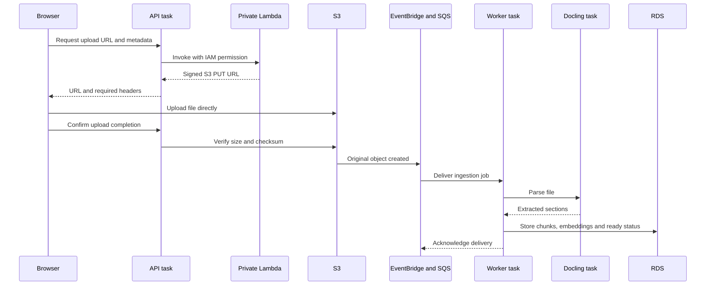

# How uploads, Fargate and deployments work

Owner: SolluCIO Cortex. These examples target **Cortex-Dev `909762691423`, Oregon `us-west-2`**. Test/Prod require their own provisioned accounts, profiles, secrets, images and approvals.

## Persistent uploads: My documents

1. The browser calculates the file's SHA-256 and calls `POST /api/documents/upload-url` on the Fastify API. The API checks login, workspace membership, upload permission, supported type, size and duplicates.
2. The API invokes `cortex-dev-upload-signer` through the AWS Lambda SDK using its task IAM role. This function is private; the browser does not call a public Lambda URL or API Gateway.
3. Lambda returns an S3 PUT URL valid for five minutes, with the required content-type/checksum headers. The API returns these to the browser. Lambda signs the request; it does not receive the file body or parse it.
4. The browser uploads the original directly to the private document bucket over HTTPS. S3 validates the signed request and checksum.
5. The browser calls `POST /api/documents/:id/upload-complete`. The API checks S3 object size and checksum and queues the document for ingestion. The original-object event also follows S3 -> EventBridge -> SQS; duplicate deliveries are handled by the worker's document claims.
6. The worker calls the private Docling parser, generates embeddings through OpenAI, stores document/chunk records in RDS and derived files in S3, then marks the document `ready` and acknowledges the SQS message. The UI polls status while this happens.



**Chat -> Attach files** is a different path: `/api/attachments/parse` sends the temporary attachment to the API/parser and returns text for the chat request. It does not create a persistent library document or upload its original through the signing Lambda. Local development also uses multipart/local storage rather than the AWS direct-upload flow.

Code owners: [presignedUpload.js](../backend/routes/presignedUpload.js), [presign.py](../infra/lambda/presign.py), the UI's `lib/documentsApi.ts`, [start-worker.mjs](../scripts/aws/start-worker.mjs), [worker.js](../backend/ingest/worker.js), and [parserClient.js](../backend/ingest/parserClient.js).

## ECS and Fargate

An image is the packaged application in ECR. A task definition is its versioned recipe: images, commands, CPU/memory, ports, IAM role, environment and secret references. A task is a running instance of that recipe. A service maintains the desired number of tasks and replaces unhealthy ones. The cluster groups the services/tasks. Fargate supplies AWS-managed compute, so the team does not manage EC2 hosts for these containers.

Dev has three continuously running services:

| Service | Containers in each task | Job | Whole-task allocation |
| --- | --- | --- | --- |
| `cortex-dev-api` | Node/Fastify API + PostgREST | Authentication, chat, upload authorization/completion and application endpoints | 0.5 vCPU / 1 GB |
| `cortex-dev-worker` | Node worker + PostgREST | Poll SQS, run ingestion, request embeddings and save results | 0.5 vCPU / 1 GB |
| `cortex-dev-parser` | Python/FastAPI/Docling | Extraction, OCR and Office rendering on private port8090 | 2 vCPU / 4 GB |

Each currently has one task; rolling releases temporarily overlap old/new tasks. API and worker use the same application image with different startup commands. Docling has its own image. PostgREST is a database HTTP sidecar, not the PostgreSQL database. Each API/worker container reaches its own sidecar at `127.0.0.1:3001`; callers reach Docling at `parser.cortex-dev.internal:8090` through private Cloud Map DNS.

All these tasks have private application-subnet IPs and no public IPs. ALB forwards permitted API traffic to private port8081. RDS lives in isolated data subnets. NAT in the public tier permits approved outbound requests such as OpenAI and AWS APIs. The frontend is static HTML/JavaScript in private S3, delivered through CloudFront and executed in the user's browser; it has no Fargate task. The upload signer is a separate Lambda in private application subnets.

Database migrations run as an additional short-lived Fargate task using the Operations task definition and restricted role. This is separate from the three services. Always obtain its current definition from the Operations stack: a later deployment can deregister an older revision.

AWS Console tour: **ECS -> Clusters -> cortex-dev -> Services -> service -> Tasks -> running task**. Inspect containers, logs, task definition, image tag and networking. See the README's [console walkthrough](../README.md#aws-console-walkthrough) for the full map.

## Normal deployment

Both repositories verify pull requests without deploying. Merging/pushing to `dev` triggers the Dev release, including documentation-only merges. GitHub uses temporary AWS credentials through OIDC. Deployment jobs are serialized per environment.

Backend workflow:

1. Install dependencies, run regression/infrastructure checks and synthesize CloudFormation.
2. Build/push an immutable ARM64 API image to ECR, tagged with commit/run/attempt.
3. Apply reviewed Data and Operations change sets.
4. Run the private database task, which records SQL migration checksums under a transaction/advisory lock.
5. Apply Application and Delivery. ECS starts new API/worker tasks, checks health and then drains old tasks.
6. Wait for CloudFormation and check the public API health endpoint.

Parser/PostgREST images are pinned separately; an ordinary API release does not rebuild them. Foundation changes, including its VPC flow-log retention, use a separate reviewed infrastructure operation. The backend release helper does not apply Foundation.

The frontend workflow builds the Next static export, uploads hashed assets before HTML, records the release and invalidates CloudFront. Old hashed assets are kept for open browser tabs. Frontend/backend releases are independent, so release a compatible backend before dependent frontend changes.

## If a pipeline fails

| Failed stage | What may have changed | Recovery |
| --- | --- | --- |
| Verification or image build | Application deployment has not begun | Read the failed step, fix the cause or retry a transient dependency/network error |
| ECR publication | Some image artifacts may exist; services still use their existing definitions | Retry with the workflow's new attempt tag; do not overwrite immutable tags |
| Data/Operations or database task | Earlier stack updates and committed database changes can persist | Inspect CloudFormation events and `/cortex/dev/database`; resolve the error before continuing |
| Application service rollout | ECS may have overlapping old/new tasks | Inspect ECS events, target health and CloudWatch; the circuit breaker can roll back a failed service rollout |
| Delivery or final health | Application may already be deployed while routing/update verification failed | Inspect Delivery events, CloudFront status and API logs; recover that stage without discarding data |
| Frontend publication | Some files may already have been uploaded | Republish the same verified export, or rebuild/redeploy the prior reviewed commit and invalidate CloudFront |

There is no transaction or automatic rollback covering every stack, database migration and S3 file. CloudFormation rollback applies to its stack; ECS rollback applies to its service deployment. Reverting an image does not undo database writes or schema migrations. Keep migrations compatible with both old and new tasks during a rollout.

Start with **GitHub -> Actions -> the failed `push` run on `dev` -> failed job/step**. Use **Re-run failed jobs** after addressing the cause. Re-running a PR verification run does not deploy. Manual dispatch also depends on the workflow being available from the repository's default branch; if its button is absent, use an existing Dev push run or the CLI path below.

If CloudFormation is busy, wait for its final state. `UPDATE_ROLLBACK_COMPLETE` can accept a corrected update; `ROLLBACK_COMPLETE` or `UPDATE_ROLLBACK_FAILED` requires explicit stack recovery. Do not delete a stateful stack or bypass the removal/replacement guards to retry.

## Manual Dev backend release or image rollback

Use a clean, reviewed backend checkout and an already published **known-good immutable API tag** from `cortex-dev-api` in ECR. This executes a real release and database migration check; inspect stack state first.

```bash
(
set -e
unset AWS_ACCESS_KEY_ID AWS_SECRET_ACCESS_KEY AWS_SESSION_TOKEN
export AWS_PROFILE=cortex-dev
export AWS_REGION=us-west-2
aws sso login --profile cortex-dev
aws sts get-caller-identity --query Account --output text

npm ci
npm ci --prefix infra
TAG='replace-with-exact-known-good-ecr-tag'
node scripts/deploy/release.mjs dev "$TAG"
)
```

STS must return `909762691423`. The helper checks this again, synthesizes with the chosen image, applies Data/Operations, runs the database task, then applies Application/Delivery. Use the current reviewed infrastructure/environment configuration, including the pinned restored-database snapshot; do not select an old saved image by accident. Finish with API health and a representative upload-to-ready check. This is the image rollback path too, provided the old application remains compatible with the current schema.

To build a new API image manually, use a unique tag, Docker ARM64 support and the same reviewed backend source. After the account check above:

```bash
(
set -e
TAG="manual-$(git rev-parse --short HEAD)-$(date -u +%Y%m%d%H%M%S)"
REGISTRY='909762691423.dkr.ecr.us-west-2.amazonaws.com'
aws ecr get-login-password --region us-west-2 |
  docker login --username AWS --password-stdin "$REGISTRY"
docker build --platform linux/arm64 -t "$REGISTRY/cortex-dev-api:$TAG" .
docker push "$REGISTRY/cortex-dev-api:$TAG"
node scripts/deploy/release.mjs dev "$TAG"
)
```

Run each step only after the previous one succeeds. These commands publish/deploy the API image and leave the pinned parser/PostgREST versions in the environment configuration. Parser dependency/image changes need their own build, review and version update.

## Manual Dev frontend publication

In a clean, reviewed **frontend** checkout, authenticate/select the same Dev profile, confirm account `909762691423`, and build the static export into `out`. The subshell stops on a failed build/check before publishing:

```bash
(
set -e
unset AWS_ACCESS_KEY_ID AWS_SECRET_ACCESS_KEY AWS_SESSION_TOKEN
export AWS_PROFILE=cortex-dev
export AWS_REGION=us-west-2
aws sts get-caller-identity --query Account --output text
npm ci
NEXT_PUBLIC_BACKEND_URL='' NEXT_PUBLIC_DIRECT_UPLOAD=true CORTEX_NEXT_DIST_DIR=out \
  npm run build -- --webpack
test -f out/index.html && test -d out/_next
GITHUB_SHA="$(git rev-parse HEAD)" node scripts/deploy/publish.mjs dev
)
```

The publisher checks the account, uploads `out` to the Dev web bucket and invalidates CloudFront. It publishes existing files; it does not build them. Use a previously reviewed frontend commit for rollback. AWS S3 file publication is not a single atomic transaction, so verify the rendered app after publication.

For current template retention settings and separate Foundation rollout, see [log retention](log-retention.md). For the pending custom-domain switch, see [the Phase A/B runbook](custom-domain.md).
